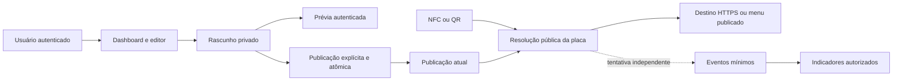

# ADSCOM NFC e Menu Digital Inteligente — arquitetura técnica

Etapa 12A.2 · 08/10/2026 · Documentação para revisão humana, sem código ou alterações de banco.

Consolidação 12A.2.7 · 14/10/2026: estratégia de produtos, Opção A e Q1–Q4 preservados; Q4.1 permite ocultar/reexibir Google sem remoção, contando-o nos 10 e mantendo-o primeiro quando visível. P1–P8 APROVADOS no escopo delimitado; P3 como abordagem com comprovação técnica pendente e P4 como abordagem com viabilidade de infraestrutura pendente. A [matriz dos contratos](nfc-contratos-tecnicos.md#13-matriz-final-de-decisões) separa aprovação, validação pendente e operações não autorizadas. Detalhes físicos/operacionais continuam abertos; sem implementação ou commit.

**Histórico:** a 12A.3.1.1 consolidou oito decisões conceituais após a análise 12A.3.1; a análise de contratos físicos 12A.3.2.1 também foi concluída, sem implementação.

**Consolidação vigente — Etapa 12A.3.2.1.1, 15/10/2026:** incorpora as decisões físicas e funcionais expressas do usuário, preservando Q1–Q4.2 e P1–P8. Somente os três documentos NFC são atualizados. P3/P4 continuam PENDENTES DE COMPROVAÇÃO; Storage privado está aprovado conceitualmente, com viabilidade operacional pendente. Não há tabelas NFC, código ou garantias de execução criados por este texto. A Etapa 12A.3.2.2 não é iniciada.

## 1. Objetivos e limites

Descrever como placas NFC e QR Code podem usar endereços permanentes, redirecionamento, menus publicados, eventos mínimos e indicadores na aplicação existente. **Aprovado** indica requisito já autorizado; **RECOMENDAÇÃO** (ou proposta de detalhamento) indica escolha técnica ainda sujeita à aprovação; **PENDENTE** indica decisão não tomada. **NÃO AUTORIZADO** identifica implementação/operação fora do escopo documental. **PENDENTE DE COMPROVAÇÃO** distingue comprovação ainda ausente de uma abordagem aprovada; não significa que a aprovação foi revogada nem que segurança foi demonstrada. Nenhuma estrutura descrita existe por consequência deste documento.

Base conferida: branch `main`, HEAD `1b757d67667891719ffc59408ee8feb89a9561f9`; na conferência da 12A.2.7, os três documentos NFC não rastreados, staging vazio e nenhum arquivo rastreado modificado. A Etapa 11D aplicou e auditou a quarta migration remotamente. Nesta etapa não houve consulta ao Supabase local/remoto nem nova validação funcional.

Fontes locais examinadas: [AGENTS.md](../AGENTS.md), [README](../README.md), [arquitetura](arquitetura.md), [plano](plano-mvp.md), [empresa/unidades](modelo-empresa-unidades.md), [perfil/presença](perfil-empresa-presenca.md), [schema de presença](schema-presenca.md), [produto NFC](nfc-produto.md), [autenticação](autenticacao.md), [dashboard](dashboard.md), [administração](administracao.md) e [Supabase](supabase.md). Os registros antigos de etapas/migrations e a prioridade anterior da Etapa 12 permanecem históricos, conforme as diferenças já registradas no documento funcional.

O código confirma sessão SSR por requisição, autorização por vínculo/papel consultado no banco e operações com RLS: [cliente SSR](../src/lib/supabase/server.ts), [contexto da empresa](../src/lib/organizations/context.ts), [requireAdmin](../src/lib/admin/access.ts), [Server Actions administrativas](../src/app/(admin)/admin/actions.ts) e [proxy](../src/proxy.ts). A [migration de canais](../supabase/migrations/20261003000100_digital_channels_foundation.sql) restringe escrita ao administrador e mantém o par empresa/unidade por FK composta; nada disso será alterado aqui.

**Aprovado:** uma aplicação Next.js, um banco Supabase PostgreSQL, Auth como identidade, organization como tenant, location opcional real, dois modos, autonomia autorizada, Menu Digital Inteligente completo incluído na placa, com recursos iniciais e futuros sem mensalidade ou cobrança adicional por funcionalidades. Separar rascunho de publicação é decisão aprovada: a versão anterior continua disponível durante a edição, a prévia é privada e sem eventos públicos, a publicação é explícita e integral, e seu alcance sobre placas compartilhadas deve ser informado.

**Responsabilidades aprovadas na 12A.2.1:** ADMIN_ADSCOM cadastra placas físicas no sistema, vincula empresa/unidade, realiza a ativação inicial e administra configurações digitais conforme autorização global. CLIENTE autorizado administra recursos digitais da própria organização, incluindo menus, destinos, publicação, vínculo menu/placa e indicadores; não cadastra placas físicas, altera sua identidade ou transfere tenant. **APROVADO na 12A.2.3:** todo CLIENTE com vínculo atual válido possui essa autonomia NFC na V1, sem permissão adicional ou hierarquia proprietário/colaborador. **Q3 APROVADO na 12A.2.4:** ADMIN e CLIENTE vinculado podem solicitar desativação operacional; só ADMIN reativa após verificação e aplica/remove bloqueios de segurança. **Q3.1 APROVADA na 12A.2.5:** o pedido não desativa imediatamente; ADMIN_ADSCOM analisa e aprova ou recusa, com efetivação somente após aprovação administrativa. Estados e precondições estão aprovados na 12A.3.2.1.1; tabelas, notificações e garantias físicas ainda exigem desenho/prova. Solicitar não concede execução direta.

**Fundação compartilhada aprovada:** novos produtos reutilizam Supabase Auth, organizations, organization_members, locations, autorização e isolamento multiempresa, sem recriar a empresa ou sua identidade. Separar módulos e contratos de acesso por produto; compartilhar identidade não autoriza compartilhar dados privados indiscriminadamente. NFC é a entrada, Agent é independente e o único produto atualmente previsto com mensalidade, e softwares especializados estão em planejamento com cobrança indefinida. Não antecipar catálogo genérico de produtos, licenças, assinaturas ou marketplace nem microsserviços.

Fora do escopo: SQL executável, schema definitivo, migrations, endpoints, editor, uploads, testes com fixtures, pagamentos, alterações de permissões e ADSCOM Agent. Não iniciar a 12A.3.2.2. As referências técnicas oficiais sustentam mecanismos gerais, não aprovam as escolhas de produto feitas aqui.

## 2. Componentes e responsabilidades

Todas as responsabilidades propostas podem permanecer no mesmo processo/aplicação Next.js, com módulos específicos e banco compartilhado. Não há necessidade demonstrada de microsserviços, filas, ORM ou um framework de permissões.

| Componente conceitual | Responsabilidade e limite |
| --- | --- |
| Dashboard autenticado | Resolver usuário e empresa, oferecer gestão e indicadores; verificar cada página e ação, além do layout |
| Gestão de placas | ADMIN cadastra, vincula empresa/unidade e ativa inicialmente; gestão digital pelo CLIENTE autorizado e ADMIN conforme matriz. Separar identidade/vínculo físico de modo, destino e vínculo de menu |
| Editor de menus | Editar rascunho privado; validar campos; oferecer prévia autenticada e publicação explícita |
| Operação de publicação | Revalidar autorização, referências e revisão; persistir conteúdo completo e trocar publicação atual atomicamente |
| Resolução pública | Receber código, conferir placa/configuração, retornar somente projeção pública ou destino aprovado |
| Renderização pública | Renderizar apenas o conteúdo da publicação resolvida, sem dados de edição, segredos ou botões ocultos |
| Registro de eventos | Aceitar apenas eventos definidos, com contexto derivado pelo servidor e limites de abuso; independente do sucesso da navegação |
| Consultas de indicadores | Agregar fatos pelo tenant, placa, unidade histórica e período; não identificar pessoas nem inferir resultados externos |

### Entidades candidatas e responsabilidades físicas

A análise 12A.3.2.1 foi concluída; o desenho abaixo incorpora as aprovações da 12A.3.2.1.1, sem criar objetos. **APROVADO** nos quatro nomes de menu abaixo significa localização conceitual dos dados; tipos, constraints e comandos finais ainda exigem desenho/prova.

| Entidade candidata | Responsabilidade | Classificação |
| --- | --- | --- |
| `nfc_plates` | Identidade/tenant permanentes, unidade administrativa atual, PREPARED/ACTIVE/INACTIVE e referência à configuração atual | Nome/colunas RECOMENDADOS; regras de identidade/estado APROVADAS |
| `nfc_plate_configurations` | Revisões imutáveis de modo/destino/menu e unidade histórica; referência de pai exato | Nome/representação RECOMENDADOS; histórico APROVADO |
| `nfc_menus` | Identidade organizacional e campos principais do único rascunho; marcadores de rascunho/alcance e publicação atual | Localização do rascunho APROVADA; representação dos marcadores/ponteiro candidata |
| `nfc_menu_draft_buttons` | Botões editáveis estruturados, posições 1–10 únicas e origem opcional no tenant | Localização e invariantes APROVADAS; tipos/constraints finais pendentes |
| `nfc_menu_publications` | Snapshot imutável do conjunto principal, com referência estável ao logo | Localização e imutabilidade APROVADAS |
| `nfc_menu_publication_buttons` | Cópias imutáveis dos botões da publicação exata | Localização e imutabilidade APROVADAS |
| `nfc_publication_attempts` | Resultado idempotente com organização, ator, menu e tentativa | Registro próprio RECOMENDADO; janela de 7 dias é referência de produto sujeita à validação |
| `nfc_plate_operations` | Pedidos e decisões operacionais, autoria histórica e estado/revisão observados | Registro específico RECOMENDADO; pedido único pendente e decisão atômica APROVADOS |
| `nfc_security_blocks` | Episódios de bloqueio/desbloqueio de placa ou destino organizacional | Registro único com alvos distintos RECOMENDADO, sem tabela por tipo |
| `nfc_events` | Fatos mínimos com contexto histórico exato, sem perfil do visitante | Registro próprio RECOMENDADO; coleta não autorizada |

Não criar tabela 1:1 para rascunho nem vínculo atual placa/menu duplicado sem necessidade demonstrada. Estado pode ser coluna da placa; referências atuais e marcador de alcance podem ser colunas das respectivas raízes. Metadata de logos, com tenant e referência imutável, deve ser desenhada junto do pipeline privado de Storage, sem definir bucket, tabela ou serviço adicional nesta etapa. Registro sobrevivente de emissão só será necessário se um futuro fluxo permitir apagar a identidade mínima da placa.

**Fundação existente:** `locations` já oferece unicidade organização/ID; a referência composta futura a `digital_channels` requer complementar esse par único. Está APROVADA a direção de acrescentar revisão monotônica de canal futuramente; ambos dependem de migration incremental autorizada, sem mudar permissões de CLIENTE ou migrations históricas. Não inferir o estado de bancos a partir dos arquivos.

**Proposta de organização:** Server Components para leituras e páginas; Client Components somente para interação do editor; Server Actions para mutações autenticadas; Route Handlers para resolução e cliques públicos. Nomes de rotas e arquivos não estão fechados. O serviço público é uma responsabilidade da mesma aplicação, não outro serviço implantado.

O diagrama preservado representa a resolução inicial da placa, cujo modo direto continua HTTPS. O clique Telefone é uma operação posterior de botão, com tel: derivado no servidor conforme contrato específico; não amplia os destinos do modo direto. Não representa acesso direto do navegador às tabelas. Rascunho/prévia ficam privados; runtime e hospedagem ainda exigem comprovação, sem reutilizar sessão SSR administrativa na superfície pública.

## 3. Identidade de placas e URLs permanentes

**Aprovado:** cada placa possui UUID interno, código público aleatório único e não sequencial, organização obrigatória e unidade opcional da mesma organização. NFC e QR contêm a URL permanente ADSCOM. O UID físico do chip não é identidade principal nem prova de posse; NFC não autentica quem aproximou o aparelho.

**P7 e formato do código — APROVADO na 12A.3.1.1:** UUID interno separado do código público, gerado a partir de **16 bytes criptograficamente aleatórios (128 bits)**, em **Base64URL sem padding, exatamente 22 caracteres**, alfabeto `A-Z`, `a-z`, `0-9`, `_`, `-`, sensível a maiúsculas e minúsculas. Código globalmente único com unicidade imposta pelo banco, independente do UID físico do chip e permanente após emissão. Rejeitar malformados, gerar novamente em colisão, não reutilizar códigos já emitidos e não reduzir entropia por truncamento inadequado. Conhecer o código não autoriza administração. NFC e QR usam a mesma URL permanente; mudanças digitais não exigem regravação. **PENDENTE:** domínio, formato definitivo da rota, DNS/TLS, implementação da geração, gravação física e conferência operacional; nenhum domínio ou caminho foi escolhido.

A URL não contém organização, nome de cliente, credenciais ou destino editável. Mesmo aleatório, o código é público e pode ser copiado. Limites de requisições e respostas neutras complementam a resistência à adivinhação, sem prometer impedir cópia física, scraping ou acesso a conteúdo já público.

Alterar modo/destino troca a configuração publicada, preservando o código e o endereço gravado. Domínio e formato da rota ainda não estão definidos; o exemplo histórico da arquitetura não é domínio provisionado nem decisão final. A permanência exige manutenção de DNS, TLS e roteamento pela ADSCOM. Transferência entre organizações permanece fora do fluxo comum, sem autorização. Reutilizar códigos já emitidos está proibido pela decisão 8; o procedimento de substituição física ainda está pendente.

**Identidade — APROVADO:** operações comuns não alteram UUID/código nem excluem fisicamente placas emitidas na V1. Exclusão futura exige evidência mínima sobrevivente dos códigos e análise de privacidade; não autoriza retenção ilimitada de eventos/dados pessoais.

## 4. Resolução pública e modos

**P4 APROVADO COMO ABORDAGEM, COM VIABILIDADE DE INFRAESTRUTURA PENDENTE:** acesso sem login, resolução no servidor Next.js pela URL permanente, verificação de estado operacional e bloqueio, destino HTTPS validado ou menu publicado, sem rascunhos ou acesso público genérico a dados de organizações. A sequência abaixo detalha o comportamento; o caminho físico mínimo de banco ainda requer validação, sem SQL ou rota implementada:

1. Receber requisição para a URL da placa; validar formato/tamanho do código e aplicar controles de abuso antes do acesso ao banco.
2. Resolver o código por operação restrita, sem aceitar organization_id, menu_id ou destino externo como autoridade fornecida pelo visitante.
3. Ler de forma consistente a disponibilidade, configuração publicada e publicação atual do menu, quando aplicável. Falta de publicação utilizável equivale a indisponibilidade pública.
4. No modo direto, obter a URL publicada e aplicar as restrições de segurança vigentes. No modo menu, obter uma projeção somente dos campos e botões visíveis da publicação resolvida.
5. Tentar registrar evento mínimo com o contexto efetivamente resolvido. A falha dessa tentativa não invalida a resolução já concluída.
6. Emitir redirecionamento temporário ou renderizar o menu. Não realizar GET/HEAD no destino externo para verificar se existe.

**Recomendação:** HTTP 302 para o modo direto e `Cache-Control: no-store` nas respostas públicas mutáveis. Não usar 301/308 que possam fixar destinos antigos. Renderização do menu pode ocorrer na própria URL da placa, preservando atribuição por placa mesmo quando várias compartilham o menu. Evitar uma URL alternativa de menu que contorne a verificação de placa ativa.

Código inexistente, placa desativada e configuração ausente devem apresentar a mesma resposta neutra proposta, sem distinguir estados privados. Indisponibilidade operacional pode resultar em 503 genérico; não revelar detalhes do banco nem usar destino de fallback não validado. Código conhecido não permite prévia, edição, leitura de cadastro ou indicadores.

Uma publicação concorrente pode fazer uma requisição já em andamento servir a versão anterior completa. O requisito é nunca misturar conteúdo de versões diferentes. Novas resoluções após a confirmação devem usar a publicação atual; desativação não pode recolher páginas ou respostas já entregues.

## 5. Menus, rascunhos e publicação

**Q4 funcional/visual APROVADO na 12A.2.5:** layout padronizado e prioritariamente móvel para todas as organizações, conforme a descrição textual do usuário. Não foram inspecionadas imagens de referência nesta etapa nem presumidos caminhos locais. A referência visual não autoriza copiar software, marca ou código de terceiros. Software avançado de restaurante continua sendo produto separado.

| Requisito funcional aprovado | Limite arquitetural a preservar |
| --- | --- |
| Logotipo circular centralizado, nome comercial centralizado e descrição curta abaixo | Conteúdo editável no menu, sem renomear silenciosamente a organização; persistência e contratos de imagem pendentes |
| Botões verticais arredondados, ícone à esquerda, título e indicador à direita | Design e biblioteca controlados pela ADSCOM, sem upload individual; oito tipos aprovados, biblioteca concreta/padrões ainda pendentes |
| Rodapé obrigatório `Powered by ADSCOM` | Não permitir remoção ou variação de layout pelo CLIENTE |
| Personalização somente de logo, nome, descrição, conteúdo dos botões e tema CLARO/ESCURO | Sem paletas individuais, fontes próprias, alteração livre de formatos ou layouts alternativos; não definir cores/fontes exatas nesta etapa |
| Máximo de 10 botões/links configurados por menu | Contar ocultos e Google; exigir invariantes também na API direta e sob concorrência, sem quota paga |
| Gestão de botões comuns | Adicionar até o limite, editar título/destino conforme tipo, reordenar, mostrar/ocultar e remover; canal da própria organização ou link personalizado HTTPS validado |
| Avaliar no Google opcional — Q4.1 | CLIENTE pode configurar/remover/ocultar/reexibir. Oculto continua nos 10 e não aparece publicamente; visível é sempre primeiro, sem reordenação. Mudança pública somente após publicação explícita; destino validado e clique não comprova avaliação |

**Correção expressa da 12A.2.5:** Q4.1 permite ocultar o Google temporariamente sem removê-lo; reexibir e publicar o devolve automaticamente ao topo. Não derivar destino de avaliação de URL genérica de perfil Google. Contagem, posição quando visível, visibilidade e destino devem ser validados no servidor e em chamadas diretas de API, não apenas no editor. Alteração de rascunho não muda a página pública antes da publicação.

**Catálogo V1 APROVADO:** Avaliar no Google, WhatsApp, Instagram, Site / Link personalizado, Localização, Telefone, Agendamento e Cardápio, exatamente oito. O [catálogo funcional](nfc-produto.md#catálogo-fechado-de-oito-tipos-da-v1) substitui os exemplos anteriores. Não altera o catálogo ou grants de canais. HTTPS é a regra dos links; Telefone é exceção fechada de tel: construído no servidor, não protocolo arbitrário.

**Editor aprovado conceitualmente:** área de identidade para exibir/editar logo, nome comercial e descrição, com seleção de tema; área de botões para listagem/adição/edição/ordenação dos comuns/controle de visibilidade inclusive Google/remoção, contador até 10 incluindo Google oculto e Google fixo no topo quando visível. Prévia em formato de dispositivo móvel reflete o rascunho privado, não gera eventos públicos e informa que alterações dependem de publicação. Controles com ícone de adição não aparecem como botões vazios no menu público.

**Publicação — APROVADO:** explícita, integral e atômica; nome comercial não vazio, pelo menos um botão visível/válido/funcional, todos os configurados válidos e nenhum destino visível bloqueado. Logo/descrição opcionais; sem logo, identidade neutra ADSCOM. Durante edição/falha permanece a versão anterior; indisponibilidade/bloqueio posterior não altera snapshot nem estado operacional silenciosamente.

**Q4.2 APROVADO:** campos estruturados de nome, descrição, referência estável de logo e tema, com botões relacionados e ícones ADSCOM sem upload individual. Posições inteiras 1–10 únicas por menu/publicação, com lacunas permitidas e reordenação atômica; Google visível na posição 1 e oculto ainda ocupa vaga. Reexibição pode reorganizar os demais atomicamente. Banco deve impedir 11º botão inclusive por API direta/concorrência. Formatos/limites de logo e protocolos funcionais estão aprovados; biblioteca concreta, parâmetros físicos finais e padrões oficiais de provedores ainda estão pendentes.

### Alternativas de armazenamento

| Alternativa | Benefício | Limite |
| --- | --- | --- |
| Uma única estrutura editável com flag publicado | Poucos objetos | Editar conteúdo já público exige cópia adicional; a flag sozinha não oferece separação nem histórico |
| Rascunho separado e cópia pública substituída em transação | Separação simples e pouca retenção | Para explicar eventos antigos, seria necessário copiar conteúdo relevante para os eventos ou manter outra referência histórica |
| Rascunho mutável e publicações imutáveis, com referência para a atual | Mantém edição privada, leitura consistente e referência histórica comum aos eventos | Exige retenção explícita e controle de quem cria publicações/troca a referência |

**P1 APROVADO:** terceira alternativa, com um rascunho privado editável por menu, publicações completas imutáveis e referência explícita para a atual, criada/trocada atomicamente em transação PostgreSQL. Qualquer validação obrigatória que falhe desfaz a publicação inteira. Preservar histórico necessário, sem ramificações, restauração automática ou event sourcing na V1. Publicações anteriores ficam restritas ao histórico autorizado sob retenção definida, nunca automaticamente disponíveis pelo endpoint público. A comparação acima permanece como registro das alternativas; a estrutura física definitiva continua pendente.

Separar conceitos de identidade do menu, conteúdo em edição, publicação e botões. Preferir atributos tipados e botões relacionados; a forma física ainda será fechada. Um snapshot estruturado só seria aceitável com contrato fechado e validação de formato, sem JSON livre substituindo relações de tenant. Conteúdo publicado preserva títulos, ordem, aparência e destinos usados naquela publicação. Referências internas a canais ficam privadas; o consumidor recebe apenas a projeção publicável.

### Edição e concorrência

**P2 APROVADO:** revisão monotônica do conjunto editável, inclusive botões, para detectar alterações concorrentes e impedir sobrescrita silenciosa. Conferir revisão antes de publicar, usar bloqueios transacionais curtos quando necessários e identificar tentativas para tratar repetições por falha de rede. Confirmar impacto sobre placas compartilhadas. **Detalhamento a validar:** comparação/incremento atômicos por toda via de escrita, incluindo API direta, e conflito que preserve a oportunidade de recarregar/comparar. Não manter locks durante edição humana; representação física e sequência exata permanecem pendentes.

**Alcance APROVADO:** confirmação inclui TODAS as placas associadas, inclusive PREPARED, INACTIVE e bloqueadas, com disponibilidade atual exibida. Lista e revisão monotônica dos vínculos precisam ser consistentes. Associação/desassociação atualiza marcador; troca entre menus atualiza ambos atomicamente com a nova configuração da placa. Mudança exige reconfirmação. Configuração atual pode representar o vínculo sem tabela duplicada. Ordem de locks, controle das demais alterações mostradas na confirmação e provas concorrentes ainda exigem desenho.

A prévia usa o mesmo contrato visual, mas leitura autenticada do rascunho, com `private, no-store`. Botões em prévia não passam pelo coletor público; não criar um parâmetro público como `preview=true` que dê acesso privado ou permita fraudar métricas. Logotipo ainda em preparação não pode ser publicado por URL de asset privado exposto acidentalmente.

### Publicação integral

Detalhamento comportamental de P1/P2/P3, sem SQL definitivo; ordem física de locks, tentativas e validações ainda exige desenho e testes:

1. Receber identidade pela sessão, menu e revisão esperada; revalidar vínculo/papel e permissão de publicação. Rejeitar identidade ou papel arbitrário fornecido no payload.
2. Conferir revisão do rascunho e da publicação atual. Serializar alterações concorrentes do mesmo menu por bloqueio pontual e ordem consistente de aquisição. Não bloquear durante edição humana ou chamadas externas.
3. Validar o conteúdo completo, todos os vínculos de tenant/unidade, URLs, visibilidade e assets prontos, além dos requisitos Q4: máximo de 10 configurados incluindo ocultos/Google, Google ocultável sem remoção, contado mesmo oculto e primeiro quando visível, tema CLARO/ESCURO e identidade visual padronizada com branding obrigatório. Referências a canais devem corresponder à revisão que o usuário revisou; divergência exige nova revisão, não importação automática.
4. Criar o conjunto publicado completo e imutável e trocar a referência atual dentro da mesma transação. Preservar o rascunho como base de edição, sem apagar alterações concorrentes não pertencentes à revisão publicada.
5. Registrar identificador da publicação, instante e autoria autenticada no tenant; confirmar o commit e retornar a identidade efetiva publicada.

Erro em qualquer passo deve desfazer a operação inteira, mantendo a publicação anterior. Várias chamadas HTTP sucessivas para gravar cabeçalho, botões e ponteiro não constituem uma transação. P1/P3 aprovam a publicação por operação restrita no banco, chamada pelo servidor, com atomicidade. A garantia de tudo ou nada deriva de [transações PostgreSQL](https://www.postgresql.org/docs/current/tutorial-transactions.html); os controles de concorrência devem seguir [bloqueios pontuais e transações curtas](https://www.postgresql.org/docs/current/explicit-locking.html).

**P3 APROVADO COMO ABORDAGEM, COM COMPROVAÇÃO TÉCNICA PENDENTE:** publicação por operação restrita no PostgreSQL, validando identidade autenticada, vínculo atual ou papel global ADMIN_ADSCOM, menu integral e privilégio mínimo. Negar alterações diretas indevidas de publicações/ponteiro. Sem uso rotineiro de `service_role` em operações de CLIENTE. Preferir privilégios do chamador se todas as invariantes puderem ser garantidas; `SECURITY DEFINER` só com necessidade técnica comprovada, proprietário restrito sem superusuário/BYPASSRLS ou propriedade de tabelas, `search_path` seguro, grants mínimos, RLS efetiva e testes de isolamento/escalonamento. Wrapper INVOKER e corpo privado DEFINER continuam uma variante em estudo, não uma função aprovada em definitivo. A [análise P3](nfc-contratos-tecnicos.md#4-autorização-e-transações) preserva evidências e lacunas: policies `TO authenticated` não dão automaticamente acesso ao proprietário técnico. Funções, grants e mudanças de fundação exigem desenho e autorização futuros; viabilidade não comprovada.

Função com elevação precisa repetir validação de conteúdo e vínculos, não depender do formulário ou do wrapper. PUBLIC/anon não devem executar publicação; execução autenticada exige autorização da organização a cada chamada. Os padrões de [funções Supabase](https://supabase.com/docs/guides/database/functions) e [segurança de funções PostgreSQL](https://www.postgresql.org/docs/current/sql-createfunction.html) exigem revisão da superfície e dos privilégios efetivos antes da implementação.

Em caso de timeout após possível commit, a interface apresenta estado incerto e consulta o resultado pela operação/revisão, sem afirmar falha definitiva ou repetir cegamente. **P2 aprovado:** identificar tentativas para reconhecer repetição; escopo físico proposto por menu/revisão ainda a detalhar, sem introduzir framework global de idempotência. Sucesso só após confirmação de publicação efetiva.

### Compartilhamento e histórico

**Proposta:** placas apontam para a identidade do menu e novas resoluções seguem sua publicação atual. Publicar esse menu afeta todas as placas que o utilizam; a prévia da publicação deve listar o alcance autorizado, sem inferi-lo de uma página parcial. Mudança concorrente nos vínculos entre placas e menu invalida a confirmação de alcance e exige atualização. O desenho transacional deve coordenar revisão de vínculos e publicação.

A configuração digital da placa — modo, destino direto e vínculo de menu — também deve ser alterada integralmente com revisão esperada, sem modificar o endereço permanente. O vínculo de unidade é responsabilidade do ADMIN, não parte da autonomia digital do CLIENTE; a direção aprovada para eventual transferência dentro do tenant exige nova revisão de configuração, mesmo sem mudança de destino/menu; execução e coordenação física ainda precisam de revisão. A decisão 6 aprova revisões imutáveis e a referência dos eventos à configuração efetivamente resolvida; a representação física segue pendente. Não é necessário replicar o mecanismo de editor visual na placa, mas nenhuma mutação pública pode expor estado intermediário.

**Logos — APROVADO CONCEITUALMENTE, PENDENTE DE VIABILIDADE OPERACIONAL:** Supabase Storage privado, upload somente por usuário autenticado com vínculo atual no tenant, processamento seguro, referência imutável por asset aprovado e entrega pública controlada sem listagem privada. Publicações históricas mantêm sua imagem; assets referenciados não são apagados. Os [limites V1](nfc-produto.md#logotipo-e-identidade-visual) estão aprovados; configuração, pipeline, cache e entrega exigem comprovação. ADMIN sem membership não ganha exceção implícita ao requisito de upload. Não configurar Storage nem conceder permissões agora.

## 6. Canais digitais existentes

`digital_channels` permanece inventário manual com oito tipos e escrita exclusiva de ADMIN_ADSCOM. CLIENTE autorizado pode ler canais de sua empresa conforme RLS; a futura autonomia no editor NFC não concede escrita nesse inventário.

**Proposta:** selecionar um canal fornece referência interna e uma cópia revisável da URL para o rascunho. A publicação fixa a URL efetivamente aprovada e não faz JOIN dinâmico à URL atual do canal para redirecionar visitantes. Referência à origem serve para revisão e rastreabilidade, não prova verificação externa.

**Canais APROVADOS:** mudanças efetivas de URL/unidade incrementam uma revisão monotônica futura, mesmo se depois revertidas. A confirmação compara a revisão revisada e exige nova prévia/publicação em conflito; nada é importado silenciosamente. A migration incremental ainda exige autorização, sem tocar a histórica ou conceder escrita a CLIENTE. Publicações antigas preservam a cópia revisada, sujeita aos bloqueios atuais.

Links personalizados pertencem ao conteúdo NFC e seguem a mesma política de URL, sem forçar novos tipos ou criar canais automaticamente. Não derivar link de solicitação de avaliação de uma URL de perfil Google por manipulação presumida. A relação futura com canal exigirá par composto do mesmo tenant; o par único necessário em canais será avaliado em migration futura, sem alterar a histórica.

**APROVADOS — Q1/Q2:** menu pertence à organização e pode atender placas de diferentes unidades dela. Canais locais de qualquer unidade dessa organização podem ser selecionados explicitamente, com unidade de origem identificada na edição e na prévia, sem herança automática. Exclusividade é por utilização: um menu usado somente por uma unidade pode depois ser compartilhado sem recriação. Não impor unidade exclusiva permanente ao menu no banco. Isso não muda o vínculo físico placa/unidade nem permite referências entre tenants. A hipótese anterior de exclusividade persistente foi superada por Q2.

## 7. Autorização e isolamento multiempresa

**Opção A APROVADA:** CLIENTE autorizado abaixo significa todo usuário com papel CLIENTE e vínculo atual válido com a organização, sem permissão NFC adicional por usuário na V1. Não significa qualquer conta autenticada. Não criar OWNER, GERENTE, COLABORADOR nem distinção entre proprietários e colaboradores. ADMIN_ADSCOM permanece global, consultado no banco, sem membership artificial. A matriz formaliza responsabilidades futuras; não representa grants ou policies já implementados.

| Operação conceitual | Consumidor anônimo | Autenticado sem acesso ao tenant | CLIENTE autorizado | ADMIN_ADSCOM |
| --- | --- | --- | --- | --- |
| Resolver placa/ler menu publicado | Projeção pública somente se disponível | Mesma superfície pública | Mesma superfície pública | Mesma superfície pública |
| Ler cadastro privado de placas/menus | Negado | Negado | Sua organização | Global, no contexto validado |
| Criar/editar menu, ver rascunho e prévia | Negado | Negado | Permitido na própria organização, conforme autorização revalidada | Permitido conforme autorização global, com validações equivalentes |
| Publicar menu e alterar modo de placa ativa/destino HTTPS permitido | Negado | Negado | Permitido na própria organização, conforme autorização revalidada | Permitido conforme autorização global, com validações equivalentes |
| Vincular menu à placa | Negado | Negado | Permitido entre recursos da própria organização | Permitido, também respeitando o tenant e o contexto |
| Cadastrar placa física no sistema | Negado | Negado | Negado | Responsabilidade aprovada do ADMIN |
| Vincular placa à empresa/unidade aplicável | Negado | Negado | Negado | Responsabilidade aprovada; validar relação empresa/unidade, sem transferência de tenant implícita |
| Realizar ativação inicial | Negado | Negado | Negado | Responsabilidade aprovada; exigir configuração válida e autorização revalidada |
| Consultar indicadores/histórico | Negado | Negado | Sua organização; recortes autorizados | Global, com escopo explícito |
| Solicitar desativação operacional | Negado | Negado | Permitido na própria organização com vínculo atual | Permitido no contexto validado |
| Analisar e efetivar solicitação operacional | Negado | Negado | Negado; solicitar não altera diretamente o estado | Q3.1: analisar e aprovar ou recusar; efetivar somente após aprovação administrativa |
| Reativar placa | Negado | Negado | Negado | Somente ADMIN, após verificação |
| Alterar identidade ou transferir tenant pelo fluxo comum | Negado | Negado | Negado | Fora do escopo; papel global não autoriza por consequência do cadastro |
| Aplicar/remover bloqueio de segurança | Negado | Negado | Negado | Somente ADMIN |
| Excluir histórico | Fora do escopo | Fora do escopo | Fora do escopo | Fora do escopo |

**Q3.2 APROVADO:** PREPARED, ACTIVE e INACTIVE são estados operacionais; não há BLOCKED operacional. Ativação/reativação só por ADMIN, sem bloqueio da placa, com organização/código válidos e configuração vigente utilizável, conferidos na transação. Direto exige HTTPS válido não bloqueado; menu da mesma organização exige publicação utilizável. Sem criar conteúdo automaticamente ou duplicar ativação já efetiva. Um pedido pendente por placa; solicitar não desativa, aprovar e passar a INACTIVE são atômicos, rejeitar não altera estado; novo pedido após rejeição é possível enquanto ativa. Decisão obsoleta é recusada. Autoria/motivo/histórico preservados. Bloqueio posterior não muda ACTIVE para INACTIVE; reativação bloqueada é recusada e desbloqueio não reativa.

O Dashboard deve manter `getUser()` no servidor, cliente SSR por requisição, verificação de vínculo/papel atual e RLS na operação final. `requireAdmin` serve somente aos fluxos administrativos; não reutilizá-lo como substituto da permissão NFC de clientes. Server Actions preservam validações de origem e POST, e recebem somente campos permitidos. Nenhuma mutação administrativa por GET. Não alterar proxy, autenticação ou grants atuais nesta etapa.

Vincular menu à placa não equivale a vincular a placa a uma empresa/unidade. A primeira operação pertence à autonomia digital autorizada; a segunda é administrativa. A logística de entrega física e os procedimentos de reassociação/substituição continuam pendentes. Código público, UUID e cookie de seleção nunca concedem nenhuma dessas permissões. Não usar `service_role` nas operações normais do Dashboard nem ampliar automaticamente escrita em `digital_channels`.

**P5 APROVADO:** integridade organizacional também no PostgreSQL, com FKs compostas e restrições adequadas, complementadas por RLS; compartilhamento e canais explícitos entre unidades do mesmo tenant, identidade permanente protegida e contexto histórico preservado. CLIENTE não transfere placas entre organizações. Toda entidade de negócio futura terá organização obrigatória, FK e índices adequados às consultas. Unidade opcional requer FK direta de organização e FK composta empresa/unidade; relações placa/menu, publicação/menu, botão/publicação e evento/recurso devem impedir cruzamento de tenants. Tenant e identidades não serão editáveis pelo CRUD comum, inclusive por admin global. FKs e constraints continuam obrigatórias mesmo quando o operador possa consultar as duas empresas.

Ativar RLS e grants mínimos no mesmo incremento que criar tabelas expostas; UPDATE exige verificação de linha anterior e resultante. Privacidade de rascunho exige isolamento também entre superfícies pública e privada, não apenas por tenant. Não ampliar `global_roles_select_own` nem introduzir ciclos entre policies de membros/papéis e novos recursos. Revogação deve negar novas operações com o mesmo JWT; não prometer interromper uma transação já em execução.

A matriz conceitual completa de tenant, pai exato e referências históricas está na [análise P5](nfc-contratos-tecnicos.md#6-relações-e-integridade-multiempresa); nenhum SQL físico foi definido.

### Fronteira do acesso público ao banco — P4 aprovado, viabilidade pendente

**P4 aprovado como abordagem:** não oferecer SELECT/RPC genérico a visitantes nem INSERT livre de eventos. Resolução obrigatória no servidor Next.js, com acesso mínimo e delimitado aos dados necessários. **Variante a avaliar:** adaptador com identidade de banco dedicada e funções privadas restritas para resolução/registro. Validar Supabase/PostgreSQL, Next.js e hospedagem pretendida, incluindo conexões, autenticação de banco, pooler, TLS, isolamento e possibilidade real dos privilégios planejados. Se inviável ou insegura, apresentar alternativas seguras à aprovação humana; não substituir silenciosamente por chave privilegiada. Não há conexão, papel ou credencial criado aqui.

Na variante de executor dedicado em avaliação, o executor público não pode publicar, editar rascunhos, consultar Auth ou listar tenants/eventos. Recebe código ou identificador de ação pública validável e devolve uma lista fechada de campos publicáveis. A implementação poderá precisar de funções privadas com elevação localizada; proprietário, grants e policies específicos devem preservar RLS, não depender de `service_role` ou de proprietário que contorne as regras. Não passar credenciais do executor ao navegador ou reaproveitá-lo no Dashboard.

O padrão atual é `@supabase/ssr`/`supabase-js` sobre HTTP com sessão e chave publicável. Não há driver PostgreSQL de runtime nem pool dedicado no `package.json`. P4 introduziria um caminho server-only novo, limitado ao público; não é reaproveitamento já validado da conexão SSR. A [análise P4](nfc-contratos-tecnicos.md#5-acesso-público-seguro) registra grants mínimos, restrição da Data API e pressupostos de Node/TLS/pool ainda sem testes.

Uma RPC diretamente executável por anon seria outra alternativa, mas permitiria chamadas fora dos limites do endpoint Next.js. Não a adotar como equivalente sem controle de abuso no mesmo ponto de entrada e revisão própria. P4 aprova o acesso público mínimo no servidor; o mecanismo físico e alternativas ainda precisam de validação e aprovação específica antes do schema pertinente, sem liberação genérica de tabelas/RPC. Limites de RLS e chaves privilegiadas estão descritos na [documentação oficial](https://supabase.com/docs/guides/database/postgres/row-level-security).

## 8. Segurança de URLs e serviço público

**P6 APROVADO:** links personalizados/externos HTTPS públicos e legítimos, sem lista fechada de domínios, validação de protocolo/formato e rejeição de internos/locais/malformados; proteção contra loops e abuso de URLs ADSCOM, consideração explícita de IDN/encurtadores, revalidação antes de redirecionar e capacidade administrativa de bloquear destinos suspeitos. Sem HTTP arbitrário ao destino para verificar disponibilidade. Sites externos podem mudar; não se promete detectar automaticamente toda fraude. A tabela detalha controles e limitações; DNS, portas, regras específicas e parâmetros operacionais ainda exigem decisões.

A abertura a plataformas não elimina as validações próprias dos tipos: Google, Instagram e Localização exigem provedores/formatos reconhecidos; WhatsApp gera o link oficial. Telefone é uma exceção fechada de botão, com `tel:` construído pelo servidor a partir de E.164 validado, nunca destino do modo direto.

| Risco | Controle de P6 e detalhamento pendente |
| --- | --- |
| Open redirect por parâmetro | Destino somente da publicação resolvida; ignorar/recusar parâmetros de destino. Botão público deve resolver ID da publicação, nunca uma URL arbitrária |
| Phishing por conteúdo cadastrado | Exibir domínio na prévia, validar todas as mudanças, prever denúncia e suspensão seletiva por responsável autorizado; não afirmar que HTTPS comprova titularidade |
| Credenciais e segredos | Rejeitar username/password e links de login/redefinição com tokens; não aceitar parâmetros evidentemente secretos. Detecção automática não identifica todo segredo; não registrar URL completa em logs |
| Protocolos e parsing | HTTPS absoluto validado para destinos diretos e tipos HTTPS; normalização conservadora sem colapsar caminhos/parâmetros. Telefone aceita somente E.164 validado convertido em tel: no servidor; nenhum esquema arbitrário |
| Destinos locais/privados | Propor rejeição de localhost, nomes internos/de rótulo único, sufixos locais e IPs literais não globais, incluindo loopback, privados, link-local, IPv6 e formas alternativas normalizadas |
| Domínio público que resolve a IP privado | Sem consulta DNS, a regra anterior não detecta todos os casos. Antes da exposição, aprovar checagem DNS limitada ou aceitar explicitamente essa limitação; DNS pode mudar depois, portanto checagem não garante destino futuro |
| Loops | Rejeitar destino direto para a própria placa e ciclos conhecidos entre placas, na configuração e resolução, com proteção concorrente. Permitir navegação legítima de botão a outro menu ADSCOM publicado, sob disponibilidade/bloqueios. Não seguir cadeias externas |
| Abuso automatizado | Limites por operação e placa, limites globais e de payload, custo de consultas limitado; valores e armazenamento do limitador pendentes. Não confiar em cabeçalhos encaminhados fora de proxies confiáveis |
| SSRF futuro | Não fazer fetch/HEAD de destinos, encurtadores, imagens remotas ou previews para provar existência. Se introduzido depois, exigir política de saída, resolução de IP, proteção contra rebinding, redirects, limites e testes próprios |

Portas não padrão, IDN/homógrafos, encurtadores e domínios recém-cadastrados precisam de regra explícita, não de bloqueios comerciais inventados neste texto. **Recomendação inicial:** restringir porta a HTTPS padrão e sinalizar domínio normalizado na prévia; exceções dependem de aprovação. O limite de URL existente em canais é referência de compatibilidade, não limite definitivo NFC aprovado.

As regras críticas precisam resistir a chamadas diretas da API/RPC, não existir apenas em TypeScript. O desenho do schema deve fechar como validações de conteúdo no banco e no servidor permanecem coerentes. Não chamar serviços de reputação nem resolver DNS nesta etapa documental.

Para o menu, propor texto escapado sem HTML/scripts arbitrários, tema restrito a CLARO/ESCURO com cores mantidas pela ADSCOM e sem entrada de paleta individual, assets aprovados e política de conteúdo do navegador. Prever `Referrer-Policy: no-referrer` para reduzir exposição da URL da placa a destinos externos. Nenhuma credencial deve existir em URL pública, bundle, exemplo ou log.

**Bloqueios e normalização APROVADOS:** ADMIN bloqueia placa ou destino específico; na V1, alvo de destino tem alcance ORGANIZACIONAL em todas as ocorrências correspondentes. Sem bloqueio global automático; bloqueios globais ficam fora da V1. Preservar histórico e snapshots; desbloqueio não reativa. Usar o mesmo contrato conservador ao cadastrar/publicar/bloquear/encaminhar: normalizar apenas equivalências comprovadas, como hostname e porta HTTPS padrão, preservando caminhos/parâmetros significativos. Rejeitar malformados, ambíguos, locais/internos, sem fetch para inferir equivalências. Contrato físico da chave, armazenamento/consulta e tratamento dos destinos não HTTPS continuam pendentes.

**Ciclos e navegação:** a proibição anterior de toda URL do resolvedor foi substituída pela distinção entre redirecionamento automático cíclico e navegação legítima entre menus. RECOMENDAÇÃO: reconhecer destinos ADSCOM sem crawling, verificar a cadeia de configurações conhecidas e invalidar análise obsoleta; concorrência entre novas arestas exige coordenação que ainda não foi provada. Destino interno precisa preservar contexto de disponibilidade/bloqueio; rota e eventual navegação pública entre organizações não foram definidos. Não confundir um link público com associação de menu entre tenants.

## 9. Eventos, métricas e privacidade

| Evento de P8 | Ponto observável a detalhar | Limite do indicador |
| --- | --- | --- |
| Acesso à URL da placa | Requisição elegível recebida; evento de tenant somente após identificar placa válida | Conta solicitações, não pessoas, aproximações ou scans únicos |
| Resolução de destino | Configuração válida resolvida; no modo direto, tentativa de emissão de redirecionamento | Não confirma recebimento/carregamento do site externo |
| Abertura de menu | Resposta pública de menu preparada/servida para uma publicação | Não prova renderização completa nem leitura humana |
| Clique em botão | Requisição elegível ao encaminhamento de um botão visível da publicação | Pode ser bot/replay; não prova intenção, mensagem, avaliação ou venda |

**P8 APROVADO:** registros mínimos de requisições às placas, aberturas e cliques, referências históricas às placas/menus/botões/publicações e indicadores isolados por tenant, com filtros por período, organização, unidade, placa, menu e botão quando o modelo permitir. Sem perfis individuais nem coleta de nome, telefone, localização precisa ou identificadores persistentes para esses indicadores. Exigir tratamento compatível com a LGPD, retenção, descarte e transparência definidos antes de ativar coleta real; sem alegar conformidade já demonstrada. Falha de métricas não interrompe menu/redirecionamento. **Detalhamento proposto:** medir no servidor, distinguir eventos de um mesmo acesso e excluir HEAD/prévia/rejeitados das interações públicas, mantendo contadores operacionais agregados sem dados pessoais.

O contexto mínimo inclui tipo de evento, instante do servidor, organização derivada, placa e revisão de configuração, unidade efetiva naquele momento (ou institucional), publicação/menu e botão quando aplicáveis. Identificadores são internos à coleta; a requisição pública não escolhe tenant, unidade, timestamp ou destino. Conteúdo e URL completos ficam na publicação/configuração histórica validada, sem duplicá-los em cada evento. Fatos não devem ser atualizados ao renomear unidade ou mudar destino.

**Configurações APROVADAS:** revisão imutável a cada mudança efetiva de modo/destino/menu; referência atual na placa e eventos ligados ao contexto utilizado. Unidade administrativa atual permanece na placa; revisão conserva a unidade histórica. Eventual transferência futura dentro do tenant, somente ADMIN, cria nova revisão mesmo sem mudar menu/destino. Transferência entre organizações não autorizada. Tipos, constraints, coordenação e execução futura ainda pendentes.

**Histórico e retenção:** autoria mínima preservada após exclusão de Auth, derivada da identidade validada no servidor e não editável pelo CLIENTE; não copiar nome/e-mail/telefone desnecessariamente. Referências V1 APROVADAS, sujeitas à validação legal/técnica: 90 dias de eventos brutos de acesso/clique, 24 meses de agregados, 30 dias de logs e 7 dias de tentativas; publicações/configurações enquanto necessárias à integridade/auditoria; identidade mínima emitida permanente, observadas obrigações legais. Descarte, backups, transparência e integridade precisam ser comprovados; coleta não autorizada.

### Cliques e páginas antigas

**Cliques APROVADOS:** validar integralmente no servidor placa, disponibilidade, bloqueios, configuração, menu, publicação, botão e destino; entrada do navegador não é autoridade. Opção C recusa contexto antigo e oferece atualização, sem destino removido/substituição silenciosa/falsa atribuição. Assinatura adicional não é obrigatória na V1; reavaliar somente se o modelo de ameaças justificar. Rate limiting, replay, fluxo de tel: e compatibilidade ainda exigem testes.

**RECOMENDAÇÃO de mecanismo:** operação interna estreita vinculada ao código da placa, configuração, publicação e botão renderizados, com destino obtido do banco; sua representação não está definida.

Assinatura adicional NÃO é obrigatória na V1. Se o modelo de ameaças justificar proteção adicional do contexto renderizado, poderá ser reavaliada referência autenticada/assinada com escopo e validade limitados. Ela não comprova pessoa nem é permissão administrativa, não deve carregar segredo ou dado pessoal e pode sofrer replay. Mecanismo, validade, limites e eventual deduplicação ficam pendentes; não aceitar simplesmente IDs e URL enviados pelo navegador.

Não persistir IP, user-agent completo, cookies de rastreamento, geolocalização precisa, referrer completo ou impressão digital do aparelho como padrão. Dados efêmeros estritamente necessários a rate limiting exigem finalidade e expiração próprias, separadas dos eventos. Retenção, informações ao consumidor e requisitos aplicáveis precisam ser definidos antes da coleta real.

Bots, prefetch, recarregamentos e chamadas repetidas podem aumentar números. Classificação de tráfego e deduplicação, se adotadas, precisam ser documentadas sem alegar precisão absoluta ou usuários únicos. Avaliações externas, vendas e contatos efetivos só podem aparecer como dados de uma integração autorizada distinta, com origem e limites próprios.

## 10. Disponibilidade e operação

| Situação | Comportamento recomendado |
| --- | --- |
| Banco indisponível na resolução | Resposta temporária neutra, sem redirecionamento inventado, sem leitura de rascunho e sem servir cache antigo não autorizado |
| Falha isolada ao gravar evento | Atender destino/menu já validado; contabilizar erro operacional sanitizado. Não acoplar escrita de telemetria à transação de resolução |
| Placa operacionalmente desativada ou bloqueada por segurança | Negar novas resoluções/cliques conforme contrato, sem revelar motivo interno nem apagar identidade, organização ou histórico; solicitação ainda não efetivada não é tratada automaticamente como desativação |
| Publicação falha antes do commit | Manter publicação anterior integralmente e rascunho privado; informar falha sem sucesso fictício |
| Resposta perdida após possível commit | Confirmar resultado pela tentativa/revisão antes de declarar sucesso ou repetir publicação |
| Conflito entre editores | Recusar revisão antiga e solicitar atualização; não substituir alterações silenciosamente |

**P8 aprovado:** falha de métricas não interrompe a navegação. **Detalhamento proposto:** resolução e registro em operações separadas, com tempo limite curto para eventos e sem espera indefinida antes de responder. Não usar tarefa solta após a resposta presumindo que o runtime garantirá execução. Aceitar perda de eventos nessa primeira abordagem e torná-la observável; filas e entrega durável só seriam avaliadas por necessidade demonstrada. Limites de tempo exatos dependerão da hospedagem e dos testes.

Começar com `no-store` para resolução, menu mutável, cliques e erros; `private, no-store` em editor, prévia e indicadores. Evitar prefetch de links de ação pública na própria UI; isso reduz, mas não elimina acessos automatizados. Assets imutáveis intencionalmente públicos podem ter política própria futura. Não introduzir cache compartilhado privado nem servir versões antigas para mascarar indisponibilidade. Testar cabeçalhos efetivos no build de produção, proxy e eventual CDN.

Observabilidade mínima proposta: totais de sucesso/erro por operação, latência, conflitos de publicação, falhas de gravação de eventos e volume de bloqueios, com identificador de correlação não pessoal. Logs não devem conter cookies, headers de autorização, payload completo, query strings, códigos públicos completos ou URLs de destino. Inspecionar também logs automáticos da hospedagem/proxy, definir retenção e controlar quem os lê.

Domínio público depende de DNS, TLS, roteamento, processo Node.js persistente, conexão/pool ao banco e segredos exclusivamente no servidor. O proxy autenticado atual cobre `/login`, `/app` e `/admin`; cabeçalhos e comportamento das futuras rotas públicas precisarão de tratamento explícito. Validar capacidade, timeouts, disponibilidade, backup/restauração e monitoramento na infraestrutura escolhida. Não prometer alta disponibilidade nem isolamento de falhas entre público e Dashboard enquanto compartilham runtime; limites de carga devem proteger ambos.

## 11. Estratégia de produtos e evolução

**APROVADO:** o ADSCOM NFC é a entrada do ecossistema: placa NFC/QR, redirecionamento direto e Menu Digital Inteligente completo. A compra inclui todas as funcionalidades inicialmente disponibilizadas e futuras do menu. Não há Menu Premium, mensalidade do menu, cobrança por novos recursos ou bloqueio de funcionalidades por plano. O modelo anterior de “essencial + Premium opcional” fica registrado apenas como histórico superado.

ADSCOM Agent é independente do NFC e atende atendimento inteligente/automação, incluindo WhatsApp. É o único produto atualmente previsto com mensalidade recorrente. Produtos especializados de restaurante e clínica permanecem em planejamento, com cobrança não definida. Fotos, vídeos, descrições, preços, pedidos e pagamentos do exemplo de software de restaurante não se tornam funcionalidades automaticamente incluídas no menu NFC.

A empresa deve adotar outros produtos sem recriar organização, usuários ou vínculos. Reutilizar a fundação compartilhada e manter os módulos separados, sem antecipar tabelas de produtos, licenças, assinaturas ou marketplace. Não modelar Agent, restaurante ou clínica nesta etapa.

Não propor verificações de elegibilidade, flags comerciais ou cobrança para o menu. Sua resolução não depende de contratação ou pagamento do Agent. Controles de segurança e disponibilidade de Q3 continuam necessários; “menu completo” não dispensa autenticação, RLS, publicação privada/atômica, privilégio mínimo, proteção dos destinos ou histórico. Recursos futuros do menu continuam incluídos, mas seu desenho e implementação exigem escopo próprio.

## 12. Matriz de riscos e testes futuros

Todos os cenários abaixo são critérios propostos, **não testes executados**. Banco significa catálogo/constraints/pgTAP; API significa acesso direto com JWTs comuns e tentativas sem sessão; servidor significa rotas/actions e falhas controladas; navegador significa experiência, cache, prévia e concorrência real. Fixtures devem ser locais, identificáveis e removíveis, sem reset ou dados de clientes.

| Risco/cenário | Resultado verificável | Camadas |
| --- | --- | --- |
| A consulta/edita/publica recurso de B por UUID ou cookie adulterado | Negação sem conteúdo privado de B e sem alteração persistida, incluindo indicadores | Banco, API, servidor |
| Placa/menu de A recebe unidade, canal, botão ou publicação de B | FK/validação recusa, inclusive para admin global; NULL institucional válido | Banco, API |
| Consumidor tenta ler rascunho por API, rota, ID ou parâmetro de prévia | Nenhum conteúdo privado, inclusive no HTML, JSON, cache e assets | Banco, API, servidor, navegador |
| Erro entre gravação de publicação, botões e ponteiro | Estado anterior integral, sem publicação órfã visível ou mistura de versões | Banco, API, servidor |
| Dois editores salvam/publicam a mesma revisão | Uma operação aceita, outra retorna conflito; sem perda silenciosa | Banco com sessões concorrentes, API, navegador |
| Escrita direta tenta ignorar revisão ou editar publicação imutável | Grants/invariantes negam; não basta impedir pela interface | Banco, API |
| CLIENTE tenta cadastrar placa física, alterar identidade, vínculo empresa/unidade ou fazer ativação inicial | Operações negadas e registro preservado; gestão digital autorizada continua possível | Banco, API, servidor |
| ADMIN cadastra/vincula/ativa inicialmente placa e administra configuração digital | Operações respeitam contexto, configuração válida, RLS e integridade; papel global não aceita par empresa/unidade cruzado | Banco, API, servidor, navegador |
| URL maliciosa, credencial, CR/LF, protocolo inseguro, destino local ou loop próprio | Rejeição em edição/publicação/resolução conforme política, sem fetch externo; casos válidos continuam aceitos | Banco para invariantes, API, servidor |
| Código inexistente/desativado ou placa sem publicação | Resposta neutra consistente, sem detalhes privados ou destino arbitrário | Servidor, navegador |
| Revogar vínculo CLIENTE ou papel global e reutilizar JWT/cookie antigo | Novas leituras privadas, prévias e escritas negadas; não interromper conteúdo intencionalmente público | Banco, API, servidor |
| Falha/timeout apenas no registro de evento | Resolução válida continua, perda aparece no indicador operacional e não em sucesso falso de gravação | Servidor, navegador |
| Mudar URL, unidade, nome ou menu após evento | Consulta histórica preserva revisão, conteúdo e atribuição efetivos; não faz JOIN indevido à configuração atual | Banco, API |
| Várias placas usam um menu | Alcance exibido completo; publicação muda novas resoluções de todas sem mistura; eventos mantêm placa de origem | Banco, servidor, navegador |
| Vínculo de placa muda após prévia do alcance | Publicação detecta conflito e exige reconfirmação; não amplia impacto silenciosamente | Banco, servidor, navegador |
| Canal muda após prévia e antes da publicação | Publicação recusa origem desatualizada; menu público anterior intacto; republicação incorpora só após revisão | Banco, API, navegador |
| Timeout após commit e reenvio | Confirma a tentativa publicada sem duplicação cega nem falso fracasso | API, servidor, navegador |
| Clique com publicação antiga ou IDs adulterados | Não segue destino arbitrário; pede atualização/nega conforme contrato e não atribui à versão errada | API, servidor, navegador |
| Bot, replay, HEAD ou prévia | Classificação coerente; prévia/HEAD não contam como interação pública; métricas não alegam pessoas únicas | Servidor, navegador |
| Cache, CDN ou cliente SSR vaza sessão/rascunho | Cabeçalhos e payloads impedem compartilhamento privado; visitante não recebe cookies/tokens administrativos | Servidor em produção local, navegador |
| Tentativa direta de usar executor público para administrar/listar | Identidade técnica só executa operações restritas; sem leitura de Auth, rascunhos ou tabelas arbitrárias | Banco, API/servidor |
| Empresa usa NFC sem contratar Agent ou outro produto | Menu completo e redirecionamento não consultam elegibilidade/assinatura comercial | Revisão de arquitetura/código e servidor em etapa futura |
| Menu usado por uma unidade passa a atender outra do mesmo tenant | Mesma identidade de menu, sem recriação ou restrição permanente; alcance revisto e canal local com origem identificada | Banco, API, servidor, navegador |
| CLIENTE solicita desativação, tenta efetivar, reativar ou remover bloqueio | Pedido autorizado no tenant não desativa; ADMIN aprova ou recusa, somente aprovação permite efetivação; CLIENTE não efetiva/reativa/bloqueia e identidade/histórico permanecem | Banco, API, servidor, conforme Q3.1 e futuro desenho físico |
| 10 configurados, ocultos e Google, com tentativa de 11º inclusive concorrente | Contagem inclui todos; adição/edição/publicação não ultrapassam 10 por chamadas diretas ou simultâneas; remover do rascunho não apaga histórico publicado | Banco, API, servidor, navegador |
| Google configurado oculto/visível, reexibição e tentativa de reordenação | Ocultar sem remover é permitido, conta nos 10 e só muda o público após publicar; reexibir/publicar retorna ao topo; API direta não permite outra posição quando visível. Destino validado sem conversão de perfil e clique não comprova avaliação | Banco, API, servidor, navegador |
| Tema/paleta/layout/branding adulterados e prévia móvel | Só CLARO/ESCURO, padrão ADSCOM e rodapé obrigatório; prévia privada reflete rascunho e não gera eventos públicos; controles de adição não são botões públicos | API, servidor, navegador |

Antes da liberação, executar regressões existentes e testes novos sem reduzir o isolamento já coberto. pgTAP privilegiado não substitui API com JWT de cliente; sucesso automatizado não elimina revisão de segurança, revisão de catálogo e teste humano da publicação/alcance. Testes devem preservar dados manuais preexistentes, sem assumir banco vazio.

## 13. Decisões e pendências

### Herdadas e aprovadas

- Uma aplicação, um banco, tenant por organização e unidade opcional real; Auth e RLS continuam centrais.
- Identidade interna separada do código público e do UID físico; NFC/QR com URL permanente.
- Dois modos; Opção A para todo CLIENTE com vínculo atual, sem permissão adicional. Q1 permite canais locais explicitamente selecionados de diferentes unidades da organização; Q2 define exclusividade apenas pelo uso, com compartilhamento posterior sem recriação ou exclusividade permanente.
- ADMIN_ADSCOM cadastra as placas físicas no sistema, vincula empresa/unidade e faz ativação inicial; também administra configurações digitais sob sua autorização global.
- Todo CLIENTE com vínculo válido escolhe modo de placa ativa, configura destinos HTTPS permitidos, cria/edita menus, vê rascunhos, publica, vincula menus às placas e consulta indicadores de sua organização. Não cria placas físicas, altera identidade ou transfere tenant. CLIENTE continua sendo o papel existente, sem novos papéis nesta etapa.
- Rascunho privado, prévia autenticada sem eventos públicos e publicação explícita com validação, efeito integral e alcance informado; sucesso somente confirmado.
- Alterar canal não muda silenciosamente publicação/histórico; não conceder escrita de canais ao CLIENTE.
- Interações não são pessoas nem resultados externos; minimização e histórico são requisitos.
- Menu completo incluído na compra da placa, com funcionalidades iniciais e futuras, sem mensalidade ou cobrança adicional por recursos. Agent é independente e o único produto atualmente previsto com mensalidade; softwares de segmento têm cobrança indefinida.
- Q3/Q3.1 distinguem solicitação operacional de bloqueio: ADMIN/CLIENTE vinculado podem solicitar sem efeito imediato; ADMIN analisa e aprova ou recusa, efetivando somente após aprovação. Só ADMIN reativa após verificação e aplica/remove bloqueios. Desenho físico continua pendente.
- Q4 aprova layout móvel padronizado, personalização restrita e temas CLARO/ESCURO, branding obrigatório, até 10 configurados incluindo ocultos/Google, Google opcional ocultável sem remoção, contado mesmo oculto e sempre primeiro quando visível (Q4.1) e editor/prévia/publicação conforme seção 5.

### Contratos P1–P8 aprovados e limites da aprovação

| Contrato | Estado na 12A.2.7 | Limite ainda aberto |
| --- | --- | --- |
| P1 — Publicações imutáveis e atômicas | APROVADO | Desenho físico do rascunho, publicações e referência atual; sem restauração automática V1 |
| P2 — Concorrência e idempotência | APROVADO | Detalhes de revisões, locks, tentativas, confirmação de alcance e testes concorrentes |
| P3 — Publicação restrita no PostgreSQL | APROVADO COMO ABORDAGEM; PENDENTE DE COMPROVAÇÃO TÉCNICA | Demonstrar segurança, necessidade de DEFINER se usado, proprietário/privilégios/RLS e impossibilidade de bypass |
| P4 — Resolução pública segura no Next.js | APROVADO COMO ABORDAGEM; PENDENTE DE COMPROVAÇÃO DE INFRAESTRUTURA | Validar conexão, autenticação de banco, pooler, TLS e isolamento; identidade dedicada/funções privadas a avaliar |
| P5 — Integridade multiempresa | APROVADO | Materializar FKs compostas, restrições e referências históricas sem schema nesta etapa |
| P6 — Segurança dos links | APROVADO | Regras específicas de DNS, IDN, encurtadores, portas, bloqueios e limites operacionais |
| P7 — Identidade permanente | APROVADO; formato consolidado na 12A.3.1.1 | 16 bytes/128 bits, Base64URL sem padding, 22 caracteres e comparação sensível a caixa definidos; domínio, rota, geração/gravação e conferência operacional pendentes |
| P8 — Indicadores, histórico e privacidade | APROVADO | Retenção/descarte/transparência antes da coleta, representação histórica e detalhes operacionais |

As análises anteriores permanecem úteis, mas aprovação de contrato não aprova automaticamente cada parâmetro sugerido. Continuam **RECOMENDAÇÃO** de detalhamento: organização em Server Components/Actions/Handlers, wrapper/corpo elevado se necessário, executor dedicado se viável, 302 e cabeçalhos de cache, DNS limitado e tratamento de encurtadores. Retenção por categoria e Opção C para cliques antigos foram expressamente APROVADAS na 12A.3.1.1, juntamente com as outras seis decisões; não permanecem alternativas de produto em aberto. Nenhum SQL, conexão ou mecanismo físico foi implementado ou testado.

### Oito decisões consolidadas na 12A.3.1.1

A matriz preserva as oito decisões de origem e incorpora os complementos expressamente aprovados na 12A.3.2.1.1. As comparações históricas permanecem como registro, não como alternativas reabertas.

| Decisão | Classificação e alcance aprovado | Detalhamento ainda PENDENTE |
| --- | --- | --- |
| 1 — Q3.2 | APROVADO: PREPARED/ACTIVE/INACTIVE, bloqueio independente, pedido único pendente, decisão ADMIN e ativação/reativação condicionadas | Representação física final, concorrência, auditoria, notificações e testes |
| 2 — Q4.2 | APROVADO: rascunho em nfc_menus, botões relacionados, posições 1–10, mínimo publicável e catálogo fechado de oito tipos; ícones ADSCOM | Campos/constraints finais, padrões por provedor, biblioteca concreta e comprovação do pipeline de logo |
| 3 — Cliques antigos | APROVADO: Opção C com validação integral no servidor; assinatura adicional não obrigatória na V1 | Representação do contexto, interface, controles de abuso/replay e testes |
| 4 — Retenção | APROVADO: por categoria; referências V1 de 90 dias, 24 meses, 30 dias e 7 dias conforme finalidade | Validação legal/técnica, descarte/agregação, backups e transparência; coleta não autorizada |
| 5 — Bloqueios direcionados | APROVADO: placa ou destino específico, alcance organizacional na V1, normalização conservadora e histórico ADMIN | Representação da identidade canônica, consulta/revogação, concorrência e testes; global fora da V1 |
| 6 — Configuração da placa | APROVADO: revisões imutáveis, referência atual, unidade histórica e nova revisão em eventual transferência administrativa no tenant | Campos, constraints, transação, retenção física e execução futura da transferência |
| 7 — Alcance do menu | APROVADO: todas as placas associadas, lista/marcador consistentes, associação/configuração atômicas e reconfirmação após mudança | Representação, locks, concorrência e testes; sem tabela duplicada de vínculo atual |
| 8 — Código público | APROVADO: 16 bytes/128 bits, Base64URL sem padding, 22 caracteres, sensível a caixa, unicidade global no banco e nenhuma reutilização de emitidos | Domínio/rota, DNS/TLS e operação de geração/gravação/conferência |

P3/P4 e a efetividade das garantias acima permanecem **PENDENTES DE COMPROVAÇÃO**. Aprovar o contrato não comprova autorização, isolamento, concorrência ou segurança operacional. Implementação, acesso a bancos e início da 12A.3.2.2 são **NÃO AUTORIZADOS** nesta etapa.

### Classificação das pendências antes da 12A.3.2.2

Esta classificação organiza quando decidir, sem aprovar a solução. **Bloqueador do schema** afeta dados, relações, invariantes, estados ou fronteiras de autorização do componente. **Antes do componente** pode aguardar enquanto esse componente não for implementado, mas deve estar resolvido antes de sua implementação/liberação. Se um próximo recorte excluir um componente pendente, isso requer aprovação explícita; não criar tabelas ou permissões provisórias para contornar a decisão.

| Questão pendente | Bloqueio antes do schema correspondente | O que pode aguardar o componente |
| --- | --- | --- |
| 1. Acesso público seguro ao banco | P4 aprovado como abordagem; validar viabilidade e escolher fronteira física mínima, RLS/grants e eventual elevação restrita | Conexão/autenticação/pooler/TLS/isolamento/carga precisam de prova antes da exposição; retornar alternativas seguras à revisão humana se inviável |
| 2. Garantias transacionais da publicação | P1/P3 aprovados: detalhar rascunho/publicação imutável, referência atual, transação restrita, proteção contra DML direto e prova de autorização | Mensagens e fluxo visual antes do editor; garantia integral não pode depender só da interface |
| 3. Validação de URLs | Fechar contrato de URL persistida, invariantes verificáveis no banco e no servidor e eventual necessidade de estado de aprovação | Detalhar normalização, DNS, portas, domínios/IPs, encurtadores e testes antes de publicar/seguir links; HTTPS sozinho não basta |
| 4. URLs potencialmente maliciosas | Bloqueios organizacionais e normalização conservadora aprovados; detalhar chave canônica, persistência, consulta/revogação e coordenação com publicação/resolução | Denúncia, triagem, limites e testes; sem equivalência domínio/URL e sem bloqueio global na V1 |
| 5. Concorrência entre editores | P2 aprovado: detalhar revisão monotônica, unidade transacional, locks curtos, alcance compartilhado e reconhecimento de tentativas | Experiência de conflito/comparação e parâmetros operacionais antes do editor/publicação |
| 6. Histórico de configurações/eventos | Revisões imutáveis de modo/destino/menu e referência atual APROVADAS; detalhar integridade, campos e transação; preservar contexto efetivamente utilizado | Apresentação de relatórios históricos antes dos indicadores, sem recalcular fatos pelo estado atual; eventual reassociação administrativa de unidade pendente |
| 7. Retenção | Referências V1 aprovadas; detalhar FKs, estratégia de descarte/agregação e identidade mínima sobrevivente | Validar legal/técnica, rotinas, backups e transparência antes da coleta; sem prazo ilimitado para eventos/dados pessoais |
| 8. Cliques em versões antigas | Opção C e validação integral aprovadas; assinatura extra não obrigatória na V1; definir contexto de placa/configuração/publicação/botão | Interface, tel: controlado, rate limiting e testes de abuso; assinatura só se ameaças justificarem |
| 9. Relações de menus e canais | Q1/Q2 preservados; marcador monotônico do alcance e coordenação atômica com revisão da placa APROVADOS. Definir representação, locks e constraints; associação atual pode derivar da configuração vigente, sem tabela duplicada injustificada | Apresentar origem e alcance na prévia; comprovar recusa de confirmação desatualizada e concorrência antes da publicação |
| 10. Geração de códigos públicos | Formato APROVADO: UUID interno distinto; 16 bytes aleatórios/128 bits, Base64URL sem padding, 22 caracteres, sensível a caixa; unicidade global e nenhuma reutilização de emitidos | Biblioteca geradora, tratamento operacional de colisões, impressão/gravação/conferência; domínio/rota pendentes |
| 11. Domínio e roteamento | Não bloqueia por si só o schema se identidade/código permanecerem independentes do host; não fixar domínio físico no modelo sem requisito | Escolher domínio, formato da rota, TLS/DNS e manutenção antes de emitir URLs ou gravar NFC/QR; exige validação da hospedagem |
| 12. Desativação operacional, reativação e bloqueio | PREPARED/ACTIVE/INACTIVE, pedido único e precondições aprovados; definir situações do pedido, transações, auditoria e armazenamento | Notificações e provas; bloqueio impede ativar/reativar, desbloqueio não reativa e bloqueio posterior não muda estado |
| 13. Contratos físicos de Q4 | Rascunho/localização, posições, mínimo e oito tipos aprovados; detalhar campos e constraints, origem versionada, referências a assets e concorrência | Padrões oficiais, biblioteca, limites de textos e comprovação de Storage/pipeline/entrega antes do componente |

Outros bloqueadores físicos: comprovar Opção A e fronteiras P3/P4, referências a assets privados, invariantes dos campos, protocolo concorrente de ciclos e de reassociação futura. Fonte do nome no rascunho, mínimo publicável, estados, pedido único e direção da transferência no tenant já estão aprovados. Não criar novos papéis de usuário; upload exige o vínculo especificado. Aprovação funcional não cria grants operacionais.

**Lista de saída para autorizar o desenho do schema:** definir o recorte futuro à luz de P1–P8 aprovados, explicitando provas pendentes de P3/P4; representação física de rascunho/publicação, concorrência, relações de tenant/unidade/menu, destinos/bloqueios, histórico/retenção, cliques antigos, códigos e ciclo de vida. Decisões aprovadas não estão reabertas por esta lista; detalhes não decididos e mudanças de fundação ainda exigem revisão/autorização. A análise conceitual 12A.3.1 foi concluída; a Etapa 12A.3.2.2 não começa aqui.

Comprimentos físicos, tipos SQL, constraints, índices e nomes finais serão desenhados somente após as decisões pertinentes. Não usar este documento como migration implícita. DNS/TLS, capacidade, conexão, monitoramento e recuperação precisam estar validados antes de exposição pública, mesmo quando não bloquearem a modelagem conceitual.

### Recorte proposto para a futura 12A.3.2.2 — sujeito à aprovação

Desenhar juntos placa/identidade, revisão de configuração, menu, rascunho/botões, publicação/botões e referência atual, tentativa de publicação e fatos mínimos de evento, com referências às organizações, unidades e canais existentes. Definir fronteiras de execução junto das entidades, evitando um CRUD provisório que depois permita contornar publicação e revisão. A [matriz final e proposta de recorte](nfc-contratos-tecnicos.md#13-matriz-final-de-decisões) detalha as condições de entrada e os testes futuros.

Esse recorte organiza o desenho remanescente, sem autorizar migrations. P3/P4 e Storage ainda exigem prova; campos/constraints, concorrência, descarte/backups e segurança operacional exigem detalhamento. Não reabrir os contratos físicos/funcionais expressamente aprovados. Restauração, substituição física completa, filas sem necessidade e analytics avançado podem aguardar; bloqueios globais estão fora da V1. Upload pode aguardar o componente, mas não ser eliminado silenciosamente do produto. Agent e softwares especializados ficam fora.

**RECOMENDAÇÃO de sequência para a futura 12A.3.2.2:** (1) fechar contratos físicos antes do schema; (2) obter comprovações técnicas de P3/P4 em escopo autorizado; (3) resolver detalhes antes do componente correspondente, antecipando os que afetem invariantes; (4) explicitar itens fora da V1. A [proposta de prioridades](nfc-contratos-tecnicos.md#proposta-de-prioridades-para-a-futura-12a322--não-iniciada) discrimina entregas e critérios. Nenhuma dessas operações é iniciada aqui.

### Questões comerciais que podem continuar pendentes

Preço da placa, condições de venda e suporte permanecem sem valores definidos. A inclusão de recursos iniciais e futuros do menu está aprovada e não autoriza quotas comerciais que bloqueiem funcionalidades por plano ou cobrança por novos recursos. A cobrança dos softwares especializados está indefinida; Agent é o único produto atualmente previsto com mensalidade. Não construir mecanismos genéricos de cobrança ou licenças agora. Limites técnicos de segurança não são franquias comerciais.

### Verificação documental e encerramento

Esta consolidação 12A.3.2.1.1 atualiza somente os três documentos NFC. Conferir seções, links locais, matrizes, diagramas, classificações, ausência de credenciais, whitespace e Git, incluindo os três arquivos não rastreados. Sem testes funcionais, SQL ou acesso ao Supabase. Nenhum staging, commit, push ou tag. As análises 12A.3.1 e 12A.3.2.1 estão concluídas; implementação, desenho físico definitivo e início da 12A.3.2.2 permanecem NÃO AUTORIZADOS. Contratos aprovados não significam segurança comprovada.

**Próximo passo recomendado:** revisão humana desta consolidação e decisão explícita sobre o recorte e prioridades da futura 12A.3.2.2, conforme a matriz dos contratos. Nenhuma transição é executada automaticamente por esta documentação.
