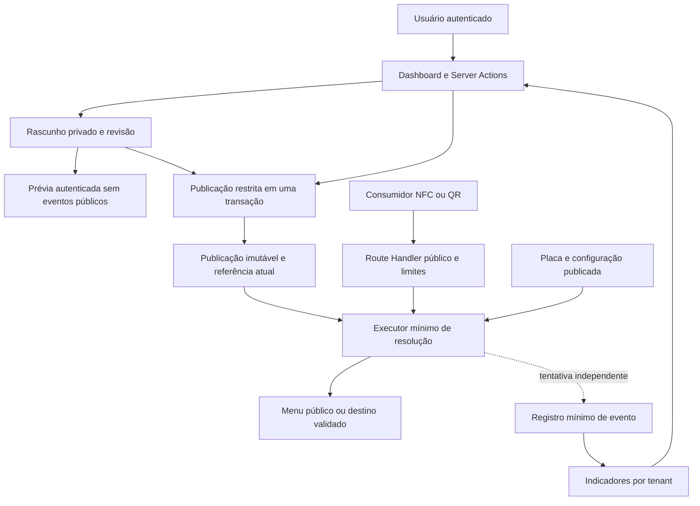

# ADSCOM NFC — contratos técnicos mínimos para revisão

Etapa 12A.2.2 · 08/10/2026 · Consolidado na Etapa 12A.2.3 em 09/10/2026; atualizado na 12A.2.4 em 13/10/2026 e na 12A.2.5 em 14/10/2026; consolidação final 12A.2.7 em 14/10/2026.

Especificação para revisão humana, sem implementação. Estratégia de produtos, Opção A e Q1–Q4.1 estão APROVADOS. P1–P8 APROVADOS nos limites expressos da 12A.2.7; P3 como abordagem com comprovação técnica pendente e P4 como abordagem com viabilidade de infraestrutura pendente. Detalhes físicos e operacionais continuam abertos. A matriz da seção 13 separa aprovação, validação pendente e operações não autorizadas.

**Histórico:** a 12A.3.1.1 consolidou oito decisões conceituais após a análise 12A.3.1; a análise de contratos físicos 12A.3.2.1 também foi concluída, sem implementação.

**Consolidação vigente — Etapa 12A.3.2.1.1, 15/10/2026:** incorpora as decisões físicas e funcionais expressas do usuário, preservando Q1–Q4.2 e P1–P8. Somente os três documentos NFC são atualizados. P3/P4 continuam PENDENTES DE COMPROVAÇÃO; Storage privado está aprovado conceitualmente, com viabilidade operacional pendente. Não há tabelas NFC, código ou garantias de execução criados por este texto. A Etapa 12A.3.2.2 não é iniciada.

## 1. Contexto e decisões herdadas

Este estudo preserva a comparação de alternativas anterior ao schema NFC e incorpora os contratos aprovados na 12A.2.7. **Aprovado** identifica somente requisitos já definidos pelo usuário. **Proposta/recomendação** identifica escolhas deste estudo que dependem de aprovação humana. Contrato aprovado também não é schema existente, migration implícita ou comprovação de segurança. As recomendações de detalhamento que ultrapassam o escopo expresso de P1–P8 permanecem assim classificadas; condições de P3/P4 são obrigatórias. Os nomes de entidades abaixo são conceituais; não fixam nomes físicos nem tipos SQL.

Base inspecionada: branch `main`, HEAD `1b757d67667891719ffc59408ee8feb89a9561f9`, staging vazio, três documentos NFC não rastreados e nenhum arquivo rastreado modificado. As fontes são [AGENTS.md](../AGENTS.md), [README](../README.md), [arquitetura](arquitetura.md), [plano do MVP](plano-mvp.md), [empresa/unidades](modelo-empresa-unidades.md), [perfil/presença](perfil-empresa-presenca.md), [schema de presença](schema-presenca.md), [produto NFC](nfc-produto.md) e [arquitetura NFC](nfc-arquitetura.md). Somente os três documentos NFC são atualizados nesta consolidação. Registros antigos de etapas e migrations não substituem o estado posteriormente confirmado na conversa.

### Requisitos aprovados preservados

1. Toda placa pertence a uma organização; pode estar associada a uma unidade real da mesma organização.
2. NFC e QR usam a mesma URL permanente. Existem os modos URL direta e Menu Digital Inteligente.
3. ADMIN_ADSCOM cadastra placas físicas no sistema, vincula empresa/unidade e realiza ativação inicial, além de administrar configurações digitais sob autorização global.
4. **Opção A APROVADA:** todo CLIENTE com vínculo atual válido pode visualizar placas, alterar modo digital de placa ativa, configurar destino HTTPS permitido, criar/editar menus, ver rascunhos/prévias, publicar versões revisadas, associar menus existentes às placas e consultar indicadores NFC da organização. Sem permissão NFC adicional por usuário na V1. Não cadastra placas físicas, altera UUID/código público, transfere tenant ou modifica o vínculo físico placa/unidade.
5. Rascunho privado editável, prévia autenticada sem eventos públicos e publicação explícita, integral e confirmada. Durante a edição, o público continua recebendo a versão anterior.
6. **Compartilhamento/Q1/Q2 APROVADOS:** menu pertence à organização e pode atender placas de suas diferentes unidades. Canais locais de diferentes unidades dessa organização podem compor o menu por seleção explícita com origem identificada. Exclusividade decorre somente da utilização atual: compartilhar depois não exige recriar menu nem remover restrição permanente de unidade no banco, pois essa restrição não deve existir. Sem referência entre tenants ou troca automática de conteúdo/destino pela unidade da placa. Prévia informa alcance e publicação afeta novas resoluções das placas vinculadas.
7. Compra da placa inclui Menu Digital Inteligente completo, com todas as funcionalidades disponibilizadas inicialmente e futuras desse menu. Não há Menu Premium, mensalidade do menu, cobrança por novos recursos ou bloqueio de funcionalidades por plano. O modelo anterior de “essencial + Premium opcional” é histórico superado pela 12A.2.4.
8. Interações não comprovam pessoas únicas, avaliações, contatos ou vendas.
9. **Q3/Q3.1 APROVADOS:** ADMIN_ADSCOM mantém cadastro físico, vínculos empresa/unidade e ativação inicial. ADMIN e CLIENTE vinculado podem solicitar desativação operacional, sem efeito imediato. ADMIN_ADSCOM analisa e aprova ou recusa; somente após aprovação administrativa a desativação se torna efetiva. Somente ADMIN reativa após verificação e aplica/remove bloqueios de segurança. Identidade, organização e histórico são preservados; estados e precondições estão aprovados na 12A.3.2.1.1; representação física final, notificações e comprovação das ações permanecem pendentes.

CLIENTE e ADMIN_ADSCOM permanecem os papéis de produto existentes. Na V1 não há distinção de autorização entre proprietários e colaboradores nem permissão NFC adicional. O vínculo atual no banco é obrigatório para CLIENTE; sua revogação impede novas operações privadas mesmo com JWT válido. Q3/Q3.1 resolvem atores e fluxo funcional de análise/aprovação ou recusa, mas não o desenho técnico das transições. Papéis PostgreSQL de execução técnica discutidos abaixo não são papéis de usuário e dependem de autorização futura.

### Estratégia de produtos e conteúdo

**APROVADO:** NFC é o primeiro produto e a entrada no ecossistema, incluindo placa NFC/QR, redirecionamento direto e menu completo. Agent é produto independente de atendimento inteligente e automação, incluindo WhatsApp, e o único atualmente previsto com mensalidade recorrente. Softwares de segmento são independentes, ainda em planejamento e com cobrança indefinida: restaurante com fotos, vídeos, descrições, preços, pedidos e pagamentos é exemplo conceitual; clínica é outro exemplo. O software avançado de restaurante não é automaticamente incluído no menu NFC.

A empresa deve adotar outros produtos sem recriar organização ou identidade: preservar Supabase Auth, organizations, organization_members, locations, autorização e isolamento multiempresa compartilhados. Separar módulos e autorizações; não antecipar tabelas genéricas de produtos, assinaturas, licenças ou marketplace nem microsserviços. Não modelar Agent ou softwares especializados aqui. Não criar elegibilidade, planos, flags comerciais ou cobrança para o menu.

**Q4 funcional/visual APROVADO na 12A.2.5, consolidado com Q4.1 na 12A.2.7:** o conjunto abaixo é requisito de produto. P1–P8 têm aprovação própria delimitada na matriz, sem autorizar execução. Consolidação baseada na descrição textual do usuário; imagens da conversa de planejamento não foram inspecionadas nesta etapa nem presumidas no repositório. Referência visual não autoriza copiar software, marca ou código de terceiros.

| Aspecto | Contrato funcional aprovado |
| --- | --- |
| Layout único, prioritariamente móvel | Logotipo circular e nome comercial centralizados; descrição curta abaixo; botões verticais arredondados com ícone à esquerda, título e indicador de navegação à direita |
| Identidade ADSCOM | Rodapé obrigatório `Powered by ADSCOM`; design mantido pela ADSCOM |
| Personalização do CLIENTE | Somente logo, nome comercial, descrição, conteúdo dos botões e tema CLARO ou ESCURO; sem paletas individuais, fontes próprias, formato livre de botões, layouts alternativos ou remoção do branding |
| Quantidade | Máximo de 10 botões/links configurados por menu, incluindo ocultos e Google quando presente; sem expansão paga ou quota por plano |
| Edição de botões comuns | Adicionar até o limite, editar título/destino conforme tipo, reordenar, mostrar/ocultar e remover; selecionar canais da própria organização ou criar links personalizados HTTPS seguros |
| Avaliar no Google — Q4.1 | Opcional; CLIENTE configura/remove/oculta temporariamente sem remoção/reexibe. Oculto continua nos 10 e não aparece publicamente. Visível deve ser primeiro, sem reordenação; reexibição publicada retorna automaticamente ao topo. Destino de avaliação validado, sem transformar URL genérica de perfil |
| Semântica de clique Google | Interação observada, nunca comprovação de avaliação publicada |
| Editor | Área de identidade editável e seleção de tema; lista/gestão, controle de visibilidade inclusive Google, contador até 10 contando ocultos e Google fixo no topo quando visível; espaços de adição não são botões públicos vazios |
| Prévia | Representação em dispositivo móvel do rascunho privado, sem eventos públicos de acesso/clique e com aviso de que mudanças dependem de publicação |
| Publicação | Ação explícita, validação integral, versão anterior preservada durante edição/falha, alcance das placas compartilhadas informado antes de confirmar; sem publicação parcial |

**Q4.1 substitui expressamente a regra da 12A.2.5:** ocultar Google não exige removê-lo. Ocultação e reexibição só afetam o público depois da publicação explícita; a edição preserva a versão publicada anterior. Contagem, posição quando visível, visibilidade, tema e destino exigem validação no servidor e nas operações diretas de API, não apenas controles visuais. A semântica de contagem de 10 permanece, incluindo Google oculto.

**Catálogo fechado APROVADO na 12A.3.2.1.1:** Avaliar no Google, WhatsApp, Instagram, Site / Link personalizado, Localização, Telefone, Agendamento e Cardápio. Os exemplos anteriores, incluindo Salvar contato e Canal direto com a gerência, permanecem apenas como histórico substituído. Regras de entrada e escopo no [produto](nfc-produto.md#catálogo-fechado-de-oito-tipos-da-v1); contratos técnicos por tipo na seção 7. Não ampliar tipos/grants de `digital_channels`.

**Q4.2 APROVADO, detalhado na 12A.3.2.1.1:** campos principais do único rascunho mutável em `nfc_menus`; botões editáveis em `nfc_menu_draft_buttons`; snapshots em `nfc_menu_publications` e `nfc_menu_publication_buttons`. Nomes descrevem desenho candidato, não objetos existentes. Nome comercial não vazio, descrição/logo opcionais, tema CLARO/ESCURO e botões estruturados. Mínimo de um visível/válido/funcional, todos os configurados válidos e nenhum destino visível bloqueado. Sem logo, identidade neutra ADSCOM. Ícones controlados pela ADSCOM sem upload individual. Logo, limite, posições e contratos dos oito tipos estão detalhados abaixo; limites de nomes/descrições, biblioteca concreta e padrões oficiais ainda pendentes.

### Compatibilidade e conflitos a revisar

O [cliente SSR](../src/lib/supabase/server.ts) usa sessão por requisição. O [contexto de empresa](../src/lib/organizations/context.ts) consulta `getUser`, vínculos e papel atual; o [controle administrativo](../src/lib/admin/access.ts) exige ADMIN_ADSCOM. As [Server Actions](../src/app/(admin)/admin/actions.ts) validam entradas e pares empresa/recurso antes da operação sob RLS. Cookie, UUID, código público ou `user_metadata` não provam autorização. O cache existente deduplica por renderização, sem compartilhar dados privados entre usuários.

As migrations de [fundação](../supabase/migrations/20260926000100_multi_tenant_foundation.sql), [unidades](../supabase/migrations/20261001000100_locations_foundation.sql) e [canais](../supabase/migrations/20261003000100_digital_channels_foundation.sql) combinam RLS, grants por coluna e FKs. CLIENTE não escreve em `digital_channels`; a autonomia NFC não amplia esse direito. A FK empresa/unidade já é composta, mas a futura referência composta a canal exigirá avaliar um par único adicional em incremento autorizado. Não alterar migrations históricas.

**Histórico de identificação:** a linha Q4.1 da 12A.2.5 agrupava pendências físicas de conteúdo; passa a Q4.2 para reservar Q4.1 à decisão humana sobre Google, sem aprovar ou eliminar as pendências anteriores.

Dois pontos não devem ser ocultados: os clientes atuais não têm uma operação transacional de publicação e a aplicação não tem executor público restrito. P3/P4 aprovam abordagens, mas `SECURITY DEFINER` exige necessidade técnica demonstrada e identidade técnica dedicada/funções privadas seguem em avaliação; não são mecanismos físicos já aprovados ou comprovados. A dívida de privilégios ambientais registrada em [administração](administracao.md) reforça a necessidade de conferir privilégios efetivos antes de implantá-las. Nenhuma correção é feita agora.

Os padrões de [pgTAP](../supabase/tests/database/003_digital_channels.test.sql) e do [harness HTTP](../scripts/test-rls-api.mjs) foram examinados somente como referência: catálogo/constraints, JWTs reais, revogação com o mesmo JWT, fixtures próprias e limpeza local. Não foram executados nesta etapa. Consultas à documentação oficial não consultam o projeto Supabase nem destinos de clientes.

## 2. Alternativas de publicação

| Alternativa | Simplicidade e manutenção | Segurança e requisitos funcionais | Histórico, compartilhamento e evolução |
| --- | --- | --- | --- |
| A. Estrutura única editável com estado publicado | Menos objetos e CRUD simples | A flag não separa conteúdo em edição do conteúdo público; editar a versão visível viola a preservação anterior. Prévia privada exige cópia/segunda representação | Placas compartilham mudanças acidentais. Acrescentar cópia para corrigir o problema aproxima a solução de B; não recomendada isoladamente |
| B. Rascunho separado e conteúdo público substituído em transação | Modelo pequeno; troca integral possível com um limite transacional claro | Prévia privada e publicação integral atendidas se todas as partes forem substituídas juntas, com acesso direto protegido | Placas compartilham a cópia atual. Eventos antigos exigem snapshots próprios ou outra retenção; custo de evolução cresce quando houver histórico |
| C. Rascunho mutável, publicações imutáveis e referência atual | Mais relações, mas regras locais compreensíveis; uma publicação é um conjunto fechado | Prévia isolada, conteúdo antigo continua servindo e referência atual troca de uma vez. Imutabilidade precisa de proteção no banco, não só convenção | Compartilhamento por identidade do menu; eventos referenciam a publicação usada. Exige estratégia de retenção, sem obrigar editor de versões ou restauração |

**P1 APROVADO — alternativa C:** um rascunho privado editável por menu, publicações completas imutáveis e referência explícita à publicação atual. Publicar atomicamente em transação PostgreSQL; qualquer falha de validação obrigatória desfaz a publicação inteira e preserva a anterior. Manter o histórico necessário, sem ramificações, merges automáticos, event sourcing ou restauração automática na V1. Publicações antigas são histórico autorizado, não superfície pública enumerável. A comparação de alternativas fica preservada como análise; tabelas definitivas não são definidas aqui. Concorrência segue P2.

**Estrutura APROVADA:** não criar tabela 1:1 de rascunho sem necessidade demonstrada; campos e botões relacionados preservam integridade. A alternativa histórica de snapshot serializado só pode ser estudada como projeção fechada, não substituto do modelo estruturado. Publicações guardam cópia completa, logo estável e botões próprios; não dependem da permanência de linhas editáveis. Nenhum JSON livre contorna relações ou validações.

### Transação proposta, sem DDL executável

1. Receber menu, revisão esperada do rascunho, referência pública esperada, revisão do alcance e identificador da tentativa. A identidade vem da sessão confiável, não do payload.
2. Revalidar autorização no banco, verificar repetição da tentativa e adquirir bloqueios curtos sobre o agregado do menu. Validar revisões depois do bloqueio.
3. Confirmar organização, unidades, canais e assets; validar nome comercial não vazio, ao menos um botão visível/válido/funcional, todos os configurados válidos e nenhum destino visível bloqueado. Verificar posições 1–10 únicas, Google visível na posição 1, tema CLARO/ESCURO e branding. Comparar revisão monotônica dos canais com a revisada, nunca importar mudança silenciosamente. Logo/descrição são opcionais; referência fornecida de logo precisa ser autorizada, pronta e estável.
4. Criar publicação completa com botões, conteúdo e destino efetivo. Trocar a referência atual e registrar o resultado da tentativa na mesma transação.
5. Confirmar o commit; responder com a identidade efetivamente publicada. Um erro desfaz o conjunto. Não apagar nem substituir um rascunho mais novo sem conferir sua revisão.

Não realizar chamadas de rede, upload ou interação humana dentro da transação. Preparação de assets deve precedê-la; falha no banco pode deixar asset não referenciado, cuja limpeza requer política própria, sem fingir transação distribuída. Múltiplas chamadas HTTP de gravação não oferecem atomicidade conjunta. PostgreSQL permite que um conjunto transacional seja visível integralmente ou não produza efeitos; isso fundamenta P1 aprovado, sem provar uma implementação futura. [Transações PostgreSQL](https://www.postgresql.org/docs/current/tutorial-transactions.html).

**Marco: BLOQUEANTE ANTES DO SCHEMA quanto ao detalhamento.** P1 está aprovado; falta representação física de publicação, botões, referência atual, retenção e proteção de escrita, junto à validação de P3. Não reabrir a escolha do contrato nem tratar sua aprovação como autorização de DDL.

### Logotipos privados e referências imutáveis

**APROVADO CONCEITUALMENTE, PENDENTE DE VIABILIDADE OPERACIONAL:** Supabase Storage privado, isolamento por tenant e upload somente por usuário autenticado atualmente vinculado à organização. O autor vem da sessão validada; tenant, caminho ou alegação de validação enviados pelo navegador não concedem acesso. ADMIN global sem membership não recebe exceção implícita a essa condição específica; eventual exceção requer decisão de autorização.

| Contrato V1 aprovado | Consequência técnica a comprovar |
| --- | --- |
| PNG, JPEG e WebP; máximo de 5 MB | Verificar conteúdo real, não extensão/MIME alegados; recusar demais formatos, SVG e GIF animado |
| Entrada até 4096 × 4096 px | Limitar dimensões decodificadas e recursos; arquivo pequeno não comprova baixo custo de processamento |
| Exibição processada dentro de 512 × 512 px | Preservar proporção, transparência aplicável e ausência de corte/distorção automática |
| Rejeitar malformados e remover metadados desnecessários | Decodificação/processamento controlados antes de marcar asset utilizável |
| Referência imutável própria por logo aprovado | Novo conteúdo recebe nova referência; não sobrescrever bytes publicados no mesmo endereço |
| Histórico e referências preservados | Não apagar assets ainda exigidos por publicações/configurações retidas |
| Entrega pública controlada | Sem listagem genérica privada nem acesso público a uploads ainda não aprovados |

**RECOMENDAÇÃO de pipeline:** recepção privada não utilizável → validação real e processamento limitado → criação de referência imutável pronta → uso em rascunho/publicação autorizados. Não manter transação de publicação aberta durante processamento ou transferência do arquivo. Falha entre Storage e PostgreSQL pode deixar objeto órfão; limpeza precisa reconhecer referências e concorrência, sem simular transação distribuída.

**RECOMENDAÇÃO de representação:** metadados de asset com organização, identificador próprio, referência/versionamento do objeto e estado de processamento; publicação referencia o asset exato. Localização física, tabela, bucket, policies, bibliotecas, formato de saída e mecanismo de entrega ainda não escolhidos. URL temporária não é identidade persistente do logo; autorização de entrega deve respeitar disponibilidade e não transformar bucket em catálogo público. Cache de imagem imutável não substitui a validação das resoluções da placa.

**PENDENTE:** comprovar configuração e permissões do Storage, pipeline/limites operacionais, entrega/cache e limpeza; especificar unidade em bytes para o teto de 5 MB e tratamento de variantes animadas não explicitadas, sem inventar aprovação. Default RECOMENDADO é falhar fechado para variante não suportada. Nenhuma configuração, upload ou teste de Storage é autorizado nesta etapa.

## 3. Concorrência e idempotência

| Alternativa | Vantagens | Riscos, manutenção e evolução |
| --- | --- | --- |
| Revisão numérica monotônica por agregado | Comparação explícita; detecta edição perdida mesmo se conteúdo volta ao valor anterior | Todas as escritas de conteúdo e botões precisam incrementar revisão no banco; não aceitar revisão escolhida livremente pelo cliente |
| Comparação de timestamp | Reaproveita informação de atualização | Precisão, serialização e timestamps iguais podem tornar o contrato ambíguo; data não exprime necessariamente mudança do conjunto. Exige cuidados que não simplificam a V1 |
| Bloqueios transacionais | Serializam uma gravação/publicação curta e protegem invariantes entre relações | Não detectam sozinhos que o formulário estava desatualizado; segurar lock durante edição humana bloquearia outros usuários. Risco de deadlock e espera |

**P2 APROVADO:** revisão monotônica do conjunto editável, detecção de concorrência, proteção contra sobrescrita silenciosa, bloqueios transacionais curtos quando necessários e validação da revisão antes de publicar. Identificar tentativas para tratar repetições por falhas de rede e confirmar o impacto nas placas compartilhadas. **Detalhamento comportamental a validar:** comparar/incrementar revisão atomicamente em todas as vias, inclusive API direta e alterações de botões; timestamp é informação temporal, não substituto da revisão. Não criar serviço distribuído de locks. A tabela abaixo conserva casos propostos para desenho e testes, sem SQL definitivo.

| Situação | Contrato proposto |
| --- | --- |
| Dois editores salvam a mesma revisão | Um salva; o outro recebe conflito e preserva a oportunidade de revisar suas alterações. Sem sobrescrita automática |
| Publicação usa rascunho antigo | Recusar, mesmo que o usuário ainda tenha acesso. Nova prévia/confirmação é necessária |
| Canal mudou depois da prévia | Detectar diferença de origem e exigir incorporação/revisão explícita; snapshot publicado anterior não muda |
| Placas foram vinculadas/desvinculadas do menu depois da prévia | Revisão de alcance muda; publicação recusa confirmação antiga para não ampliar impacto silenciosamente |
| Timeout após possível commit | Estado incerto; consultar resultado pela tentativa sob autorização atual. Não anunciar fracasso nem sucesso sem evidência |
| Mesma solicitação repetida | Reconhecer tentativa já confirmada e retornar sua publicação, sem nova cópia. Se outra publicação já a substituiu, informar a publicação daquela tentativa e a atual, sem confundi-las |
| Mesma chave com conteúdo diferente | Recusar conflito de uso; não reaproveitar resultado de outra intenção |

Propor registro mínimo da tentativa, vinculado a organização, ator, operação, menu e chave, com impressão digital do pedido e resultado confirmado. Inserção do registro e publicação participam da mesma transação; tentativa abortada não fica marcada como sucesso. Concorrência da mesma chave deve ter unicidade no banco e rechecagem do resultado após espera. Autorização é conferida antes de retornar resultado antigo: idempotência não conserva acesso revogado.

A retenção da tentativa define a janela de reconhecimento. Após expiração, a revisão esperada ainda deve impedir republicação cega de pedido antigo; não prometer exatamente uma execução para sempre. Digest não inclui credenciais e não substitui validação de conteúdo. Não persistir um status “em andamento” em transação separada sem necessidade, evitando recuperação complexa de tentativas abandonadas.

**Alcance APROVADO:** a confirmação inclui TODAS as placas atualmente associadas, inclusive PREPARED, INACTIVE e bloqueadas, mostrando disponibilidade atual. Lista e marcador monotônico precisam corresponder ao mesmo estado consistente. Associar/desassociar atualiza marcador; mover entre menus atualiza ambos atomicamente com a revisão da placa. Mudança de associação recusa confirmação antiga. Vínculo atual pode derivar da configuração vigente, sem tabela paralela injustificada. **RECOMENDAÇÃO:** locks de menus em ordem determinística, revalidação após espera e protocolo único para todas as mutações; decidir o tratamento de mudanças de disponibilidade exibida sem confundi-las com alteração de vínculo. Os [bloqueios PostgreSQL](https://www.postgresql.org/docs/current/explicit-locking.html) são referência, não prova.

**Marco: BLOQUEANTE ANTES DO SCHEMA.** Revisões, unicidade de tentativas e coordenação de vínculos afetam persistência. Mensagens de conflito podem aguardar a interface, mas não a definição do resultado da operação.

## 4. Autorização e transações

| Alternativa | Simplicidade e vantagens | Limitações para o contrato exigido |
| --- | --- | --- |
| Grants/RLS e DML normal | Segue o CRUD existente; bom para leituras e escritas simples | Se usuário recebe INSERT/UPDATE de publicação/ponteiro, pode tentar chamar API diretamente. Constraints/triggers poderiam impor invariantes, mas seria necessário provar toda combinação de DML, com maior manutenção |
| RPC SECURITY INVOKER | Agrupa etapas sob sessão e RLS do chamador; não eleva privilégio | Exige os privilégios de DML do chamador nas tabelas usadas. Portanto, sozinho não resolve “executar publicação sem receber escrita direta” |
| Operação restrita com elevação localizada | Concede EXECUTE de uma ação fechada sem liberar DML das estruturas publicadas | Corpo, proprietário, grants, policies, identidade e parâmetros viram fronteira crítica. Mais revisão e testes, mas escopo pode ser pequeno e explícito |

**P3 APROVADO COMO ABORDAGEM, COM COMPROVAÇÃO TÉCNICA PENDENTE:** publicação por operação restrita no PostgreSQL, verificando identidade autenticada, vínculos atuais, papel global ADMIN_ADSCOM e menu integral. Privilégios mínimos e proibição de alteração direta indevida das versões publicadas; sem uso rotineiro de `service_role` em operações de CLIENTE. `SECURITY DEFINER` somente se a necessidade técnica for comprovada; se usado, exigir proprietário restrito, sem BYPASSRLS, `search_path` seguro, grants mínimos, RLS efetiva e testes específicos de isolamento/escalonamento. A variante com elevação localizada analisada abaixo permanece condicionada, não é implementação escolhida por antecipação. Leituras autenticadas continuam com sessão normal. INVOKER mais invariantes é alternativa de estudo somente se impedir todos os caminhos de DML indevido; não usar privilégio maior para resolver falha de RLS de CRUD comum. Viabilidade não comprovada.

### Condições da operação elevada, somente se sua necessidade for comprovada

- Sessão Supabase do usuário chama entrada mínima autenticada. Corpo com elevação fica em schema privado não exposto à Data API; uma entrada RPC INVOKER pode encaminhar a chamada. O corpo é a fronteira de segurança: esconder o schema ou usar wrapper não substitui suas validações.
- Proprietário técnico sem login, sem superusuário, sem BYPASSRLS, sem criação de papéis/schema e sem propriedade das tabelas acessadas. Não conceder ao usuário, ao executor público ou a authenticated capacidade de assumir esse papel. Não fazer dele membro de um papel amplo apenas para herdar acesso.
- Grants do proprietário limitados às leituras necessárias e às colunas/objetos que a operação escreve. Sem DDL, DELETE de histórico, escrita em Auth/vínculos/papéis ou acesso genérico a outros módulos. Não usar `service_role`.
- RLS habilitada nas tabelas de negócio e policies aplicáveis ao papel técnico, ainda vinculadas ao usuário da requisição. Não assumir que policies `TO authenticated` se aplicam a outro papel. Proprietário de tabela normalmente contorna RLS; por isso a separação de propriedade é indispensável. FORCE RLS pode ser defesa adicional, não desculpa para usar superusuário.
- `auth.uid()` deve ser não nulo e derivado do JWT validado pela infraestrutura, com vínculo/papel atual confirmado no banco para aquela organização. Não aceitar `user_id`, papel, organização selecionada ou alegação “já autorizado” como prova enviada pelo navegador. O contexto de claims não pode ser definido por função pública nem por acesso SQL arbitrário do cliente.
- Usar `search_path` fixo sem schemas graváveis por usuários não confiáveis, objetos qualificados e parâmetros tipados/validados; evitar SQL dinâmico. Não permitir que objetos temporários ou nomes controlados pelo chamador substituam os objetos pretendidos.
- Revogar EXECUTE padrão de PUBLIC e anon na entrada e no corpo; conceder apenas o necessário ao caminho autenticado. Caso o wrapper INVOKER exija que authenticated execute o corpo privado, este deve ser igualmente seguro em chamada direta autorizada e não confiar no wrapper. Restringir USAGE/CREATE dos schemas; schema privado não concede segredo por si só.
- Negar DML direto de publicações, botões publicados, ponteiro e resultados de tentativas para authenticated/anon. Escritas do rascunho também precisam impedir bypass da revisão: recomendar comandos estreitos para o agregado, em vez de CRUD livre de botões.
- Revalidar todas as referências, revisões e invariantes no corpo. Não aceitar sinalizadores “URL válida”, “admin” ou “publicado” do cliente. Erros devem evitar revelar conteúdo ou existência de recursos de outra empresa.

As condições acima detalham a variante de elevação ainda a comprovar, respeitando P3 aprovado como abordagem. O detalhamento se baseia nos mecanismos documentados de [RLS PostgreSQL](https://www.postgresql.org/docs/current/ddl-rowsecurity.html), [CREATE FUNCTION](https://www.postgresql.org/docs/current/sql-createfunction.html) e [funções Supabase](https://supabase.com/docs/guides/database/functions). Ainda não foram testados no projeto.

### Compatibilidade com o código e as policies atuais

A classificação abaixo é documental. Não foram inspecionados catálogos de um banco em execução nesta etapa; atributos efetivos, heranças, default privileges e concessões ambientais ainda exigem auditoria futura autorizada.

| Classe de evidência | Mecanismo e evidência local | Consequência para P3 |
| --- | --- | --- |
| 1 — Comprovadamente compatível com as regras atuais, no código versionado | Sessão normal via SSR e chave publicável; `requireAdmin` consulta concessão global própria; contexto consulta vínculo atual. Grants SELECT e policies das cinco tabelas são destinados a authenticated | Reutilizar identidade e leitura autorizada; não existe publicação NFC comprovada. Não confundir ADMIN_ADSCOM, valor em tabela, com superusuário ou papel PostgreSQL |
| 1 — Contrato atual de autorização | `global_roles_select_own` restringe à identidade de `auth.uid()`; `members_select_own_or_admin` vê vínculo próprio ou vínculos sob papel global próprio. Organizações, unidades e canais dependem desse grafo sem ciclos | ADMIN global não precisa de vínculo artificial; CLIENTE precisa de vínculo da organização. Não ampliar leitura de papéis globais para facilitar NFC |
| 2 — Plausível, dependente de testes | RPC INVOKER transacional usando privilégios existentes para leituras | Pode preservar JWT/RLS, mas não tem DML para estruturas NFC inexistentes. Se receber DML de publicação/ponteiro, abre o acesso direto proibido; INVOKER sozinho não satisfaz P3 |
| 2 — Plausível, dependente de testes | Corpo DEFINER privado com proprietário técnico mínimo, sem propriedade de tabelas/BYPASSRLS | Satisfaz a separação entre EXECUTE e DML em tese; precisa testar identidade, policies efetivas, revisões, revogação, concorrência, chamadas diretas e rollback |
| 3 — Exige alteração autorizada da fundação | Conceder ao proprietário técnico leituras estritas de autorização e de referências existentes, com policies aplicáveis ao novo papel | A fundação atual não autoriza esse executor. A variante recomendada demanda incremento explícito, separado da aprovação de produto e sem editar migrations históricas |
| Inadequado ao contrato | CRUD livre de publicações/ponteiro; INVOKER com DML liberado e proteção só no Next.js; função de dono privilegiado; service_role | Permite contornar invariantes ou RLS. Não é alternativa aceitável por conveniência |

Nas policies existentes, alguns testes de ADMIN procuram a existência de uma concessão sem repetir o usuário porque `global_roles_select_own` já restringe as linhas visíveis. Copiar esse predicado para papel capaz de ler concessões alheias promoveria indevidamente clientes. No desenho futuro, tornar explícita a comparação do usuário e papel tanto na validação quanto nas policies; conservar o grafo autorização → recursos, sem retorno às tabelas NFC.

**Regra de autorização aprovada para a operação digital (Opção A/P3):** identidade não nula e, no banco, concessão atual ADMIN_ADSCOM do próprio usuário **ou** vínculo atual CLIENTE com a organização do recurso. Não exigir autorização NFC adicional. Depois, validar a operação específica: publicação não concede cadastro físico, edição da unidade ou efetivação operacional pelo CLIENTE; Q3.1 exige análise e aprovação administrativa. Alteração de modo por CLIENTE exige placa ativa. Erro de leitura de autorização nega a operação.

Grants e RLS são barreiras diferentes: RLS não concede o privilégio de tabela ausente e EXECUTE de INVOKER não empresta DML. DEFINER muda o papel efetivo para o proprietário da função, mas só preservará RLS se este estiver sujeito a ela e às policies certas. Nunca presumir isso a partir da palavra DEFINER, de um wrapper ou do schema privado.

### Dependência explícita com a fundação atual

Se adotado após comprovação, o papel técnico precisará consultar o vínculo e a concessão global próprios do usuário e as referências autorizadas. As policies atuais destinadas a authenticated não bastam automaticamente. Uma opção é aprovar grants de leitura mínimos e policies adicionais estritas para esse papel, limitadas a `auth.uid()` nas tabelas de autorização, sem ampliar `global_roles_select_own` para clientes nem criar ciclo de dependências. Isso seria alteração futura explícita na fundação, **não autorizada nesta etapa**. Também avaliar privilégios das referências existentes a organizations, locations e digital_channels: novas policies do papel técnico podem precisar repetir o mesmo predicado de autorização, sem ampliar SELECT de clientes. Outra opção é redesenhar o caminho com privilégios do chamador e invariantes adicionais. Não selecionar proprietário privilegiado como atalho para evitar essa revisão.

### Requisitos mínimos adicionais e critério de aceite de P3

- Auditar privilégios efetivos de PUBLIC, anon, authenticated, proprietário técnico e executor público, inclusive herança, grants por coluna, schemas e funções sobrecarregadas. Revogações devem integrar o mesmo incremento de criação, sem janela de EXECUTE público. Default privileges existentes não podem deixar a exceção aberta.
- Separar proprietário das tabelas, proprietário das funções e login público de runtime; este último não pode assumir os anteriores. Privilégios normais de catálogo não equivalem a permissão de consultar dados de clientes, mas leitura/DML/DDL em objetos do produto deve permanecer fechada.
- O corpo deve validar `auth.uid()` e autorização antes de ler rascunho/retornar tentativa anterior; schema privado não é guarda de identidade. Claims definidos arbitrariamente pelo chamador ou GUC “autorizado” não servem como prova. Nenhum helper exposto pode forjar o contexto.
- Novas policies precisam proteger estado anterior e resultante conforme a operação; escrita do ponteiro só pela operação autorizada, identidade/tenant imutáveis, publicações e botões sem UPDATE/DELETE comum. Rascunho, revisão e alcance devem mudar juntos em todas as vias.
- Usar comandos de finalidade fechada, sem nomes de tabela/coluna, SQL ou destino livre fornecidos ao corpo privilegiado. Validar quantidade de linhas e rollback integral; não transformar erro de autorização em sucesso idempotente.
- Rejeitar a adoção se não for demonstrável, em teste local futuro, que authenticated não pode fazer DML direto, que anon/PUBLIC não executam publicação e que um JWT revogado não conserva acesso. Não utilizar privilégio maior para fazer o teste passar.

O trigger existente `set_digital_channels_updated_at` é INVOKER e apenas mantém timestamp, com EXECUTE revogado para a API; não constitui precedente de uma publicação privilegiada nem solução de revisão do agregado NFC. Adicionar triggers para impor um protocolo de publicação seria outra implementação a revisar, não uso gratuito da estrutura atual.

| Garantia | Banco | Aplicação |
| --- | --- | --- |
| Identidade e autorização | Revalidar usuário/vínculo/papel em cada comando e RLS aplicável | `getUser`, contexto autorizado por requisição e controle de cada página/action |
| Isolamento e imutabilidade | Grants, RLS, FKs compostas, tenant/IDs protegidos e DML público negado | Validar IDs e filtrar empresa/recurso; não confiar em cookie ou formulário |
| Publicação | Revisão, referências, validação mínima independente, transação e resultado durável | Prévia privada, alcance informado, ação explícita e confirmação efetiva |
| URLs e abuso | Impedir persistência/publicação fora do contrato estrutural; não confiar em booleano do cliente | Parser/UX e controles operacionais; endpoint revalida política antes de encaminhar |

Revogação deve negar novas chamadas com JWT antigo; uma transação já iniciada pode observar o estado de autorização de seu snapshot. Garantia de interrupção imediata exigiria coordenação adicional e não é prometida. Desativação/reativação não recebem permissões por consequência da publicação. Não criar papéis OWNER/GERENTE/COLABORADOR.

**Marco: BLOQUEANTE ANTES DO SCHEMA quanto à comprovação e desenho.** P3 aprovado como abordagem não comprova viabilidade nem aprova funções/grants físicos. Demonstrar necessidade de elevação se utilizada, proteção de escrita, policies aplicáveis e ausência de escalonamento antes de autorizar sua implementação; sem criar funções nesta etapa.

## 5. Acesso público seguro

| Opção | Simplicidade, segurança e manutenção | Evolução e limites |
| --- | --- | --- |
| RPC restrita executável por anon | Menos credenciais de runtime; resposta pode ser estritamente limitada ao conteúdo publicado | Chamável diretamente na Data API: controles só no Next.js são contornáveis. A própria fronteira RPC/gateway teria de limitar abuso e impedir enumeração/listagem; não aceita promessa de rate limit apenas na aplicação |
| Adaptador server-only com executor mínimo | Centraliza limites e observabilidade; navegador não recebe credencial nem acesso ao banco | Exige conexão/pool, segredo operacional e grants corretos. Comprometimento do servidor ainda permite abuso das funções concedidas; sua superfície deve ser pequena |
| Projeção pública dedicada ou artefato estático publicado | Separação material de rascunhos, boa capacidade de cache | Publicação, invalidação, desativação e vínculo à placa ficam mais difíceis; SELECT anônimo pode permitir listar tudo. Se view, é preciso revisar segurança de execução. Não simplifica o requisito de disponibilidade mutável da V1 |

**P4 APROVADO COMO ABORDAGEM, COM VIABILIDADE DE INFRAESTRUTURA PENDENTE:** acesso público sem login resolvido no servidor Next.js pela URL permanente, conferindo estado operacional/bloqueio e retornando somente redirecionamento HTTPS validado ou menu publicado. Sem rascunhos, SELECT/RPC genérico para visitantes ou acesso público genérico a dados organizacionais; limitar acesso ao estritamente necessário. **Variante física a avaliar:** adaptador server-only com identidade de banco dedicada e funções privadas restritas. Não é novo microsserviço. Verificar na infraestrutura pretendida Supabase/PostgreSQL, Next.js, conexões, autenticação de banco, pooler, TLS, isolamento e capacidade real dos privilégios. Se houver impossibilidade ou risco não resolvido, apresentar alternativas seguras à aprovação humana. Não substituir por credencial privilegiada nem afirmar viabilidade já demonstrada.

Na variante dedicada em avaliação, o executor de runtime deve poder executar apenas comandos fechados, sem SELECT/DML direto das tabelas, sem Auth, edição, publicação, listagem de organizações ou alteração de grants. Funções privadas podem usar proprietário restrito distinto, não dono de tabelas e sem BYPASSRLS, com acesso somente ao conjunto publicado/configuração e escrita de eventos validados, protegido por policies próprias. Rascunhos e dados administrativos não precisam estar nos privilégios desse proprietário. Diferenciar resolver conteúdo de registrar evento evita conceder escrita onde só leitura é necessária.

Nessa variante, as funções de resolução pública conceituais não autenticam consumidor por `auth.uid()`: recebem código/ação pública, derivam a placa e tenant no banco e retornam projeção fechada. Não aceitam organização ou destino livre como autoridade. Papéis anon/authenticated não recebem EXECUTE dessas funções através da Data API; o caminho é o adaptador. Isso mantém o rate limiter no caminho obrigatório dos visitantes comuns. O executor não pode assumir o papel proprietário da função; o corpo não aceita SQL arbitrário.

Rotas públicas não usam cookies administrativos nem cliente SSR do visitante. O código identifica placa, sem conceder prévia, cadastro, indicadores ou edição. A resolução devolve somente campos publicados e botões visíveis. Não oferecer API pública de busca/listagem por tenant nem URLs de versões antigas que contornem placa ativa.

**Fluxo proposto:** limitar entrada → resolver código e disponibilidade → obter configuração/publicação coerentes → aplicar política atual de destino → tentar evento independente com tempo limite → responder menu ou 302. `no-store` inicialmente em resolução, menu mutável e cliques; `private, no-store` na administração. Código inválido, placa desativada ou sem configuração respondem de forma neutra; erro do banco não inventa destino nem serve rascunho. Falha de evento não bloqueia navegação já validada.

Limites por placa/operação e globais devem proteger o banco e o Dashboard, que compartilham runtime. Identidade/IP efêmeros para controle de abuso exigem finalidade e expiração, não inclusão automática em métricas. Logs devem registrar status, duração e correlação não pessoal, sem JWTs, cookies, query strings, códigos completos ou destinos completos. O domínio e a hospedagem precisam permitir essa política também nos logs de proxy/CDN.

### Viabilidade e lacunas de P4 no projeto

**Evidência atual:** [server.ts](../src/lib/supabase/server.ts) usa SSR/Supabase sobre HTTP, e [package.json](../package.json) não declara driver PostgreSQL de runtime. A aplicação não possui pool SQL próprio. [config.toml](../supabase/config.toml) expõe somente `public` na configuração local versionada; isso não confirma a configuração real de qualquer ambiente. A [API de Route Handlers do Next.js](https://nextjs.org/docs/app/getting-started/route-handlers) oferece o componente servidor apropriado, mas nenhum handler NFC foi criado/testado.

**Proposta de privilégios:** login técnico exclusivo do runtime, com CONNECT ao banco, USAGE apenas nos schemas necessários e EXECUTE das assinaturas estritamente necessárias. Sem SELECT/DML das tabelas do produto, CREATE, BYPASSRLS ou membership em papéis administrativos. Resolver e registrar podem ter proprietários distintos: leitura do conjunto publicado para um e INSERT de fatos mínimos para outro, ambos sujeitos às policies específicas. Não entregar ao runtime o papel proprietário. Esconder função da Data API não basta: revogar EXECUTE/USAGE indevidos para anon/authenticated/PUBLIC e conferir memberships, schemas expostos e ausência de wrapper público equivalente.

Sem usuário autenticado no tráfego público, `auth.uid()` normalmente não identifica o visitante. Não fabricar JWT ou identidade CLIENTE para essa resolução. RLS do executor limita sua finalidade, mas o acesso a publicações de vários tenants é necessário ao serviço; código validado e corpo da função derivam o tenant de cada resposta. Uma conexão comprometida pode invocar as operações permitidas em massa: privilégio mínimo limita o dano, não substitui proteção dos segredos e do host. Nenhuma função de registro deve confiar em IDs independentes de organização/placa/publicação enviados ao visitante; validar a combinação histórica resolvida, sem exigir que o ponteiro continue atual depois de uma resolução válida.

**Pressupostos sem validação prática:**

1. Possibilidade de provisionar papel técnico com login e grants estritos no ambiente contratado e verificar que PUBLIC/default privileges não acrescentam poderes inesperados. A aprovação de P4 não aprova uma credencial administrativa substituta.
2. Hospedagem Node.js com conectividade de saída, TLS com verificação do servidor, limites de conexão, armazenamento/rotação de segredo e recuperação operacional. Não há prova de suporte do plano Hostinger nesta tarefa.
3. Escolha de conexão direta ou pool compatível com papel técnico, rede e duração do processo; pool pequeno e limitado por processo, considerando soma entre réplicas. Não adotar uma conexão nova ilimitada por acesso nem herdar estado de sessão/claims entre visitantes. A documentação de [conexões Supabase](https://supabase.com/docs/guides/database/connecting-to-postgres) diferencia conexão direta e modos de pooling; o modo transacional impõe limitações de estado de sessão e prepared statements. Validar driver e modo em teste próprio antes de adotá-los.
4. Módulo server-only e chamadas parametrizadas de operações fixas, sem entrada que determine SQL; segredo fora de NEXT_PUBLIC, bundles e logs. Credencial do público nunca reutilizada para o Dashboard autenticado.
5. Limites antes do banco em **todas** as rotas de acesso, renderização e clique, com endereço de cliente obtido apenas de proxy confiável. Controles por processo não garantem limite global; definir solução compatível com o deployment. Testar que API/RPC direta não contorna essa fronteira.
6. Timeout curto de resolução falha fechado, sem destino alternativo ou rascunho. Erro sanitizado e sem retry ilimitado; falha independente de evento permite navegação válida e indica perda. Observabilidade mede falhas/latência sem conteúdo privado.

**Comparação decisiva:** RPC anon evita novo login SQL de runtime e usa o transporte já conhecido; em troca, a Data API se torna outra entrada pública. Sem limitação equivalente obrigatória nesse caminho, não atende ao controle de abuso proposto. Se a variante de P4 for inviável, apresentar alternativas seguras, inclusive avaliar RPC/gateway restrito com testes e aprovação específica, sem liberar SELECT anônimo de placas ou introduzir service_role. Suporte geral de Next.js/PostgreSQL não comprova que o executor esteja implantável ou seguro no ambiente atual.

**Marco principal: BLOQUEANTE ANTES DO SCHEMA**, pois escolhe grants, funções e projeções. Pool, domínio, TLS, parâmetros de rate limit, sanitização de logs e validação operacional são **BLOQUEANTES ANTES DO ENDPOINT PÚBLICO**. Não criar papéis, credenciais ou conexões agora.

## 6. Relações e integridade multiempresa

**P5 APROVADO:** integridade organizacional também no PostgreSQL, FKs compostas e restrições que impeçam relações entre tenants, com RLS complementar. Compartilhamento e canais explícitos entre unidades da mesma organização; contexto histórico e identidade permanente protegidos, sem transferência de placa entre organizações por CLIENTE. A matriz conserva relações conceituais para o desenho; não define schema físico.

| Relação conceitual | Detalhamento de integridade de P5 |
| --- | --- |
| Organização → unidade | Organization é a raiz do tenant, não filha de outra empresa. Unidade tem tenant obrigatório; modelo existente mantido. Empresa pode ter zero unidades |
| Organização → placa | Organização obrigatória; identidade interna e tenant imutáveis no fluxo comum |
| Placa → unidade opcional | FK composta por organização/unidade, além da FK obrigatória de organização. Ausência significa institucional, não todas as unidades |
| Placa → revisão de configuração | Revisão pertence à mesma organização e à mesma placa; referência composta inclui ambas as identidades. Configuração atual deve apontar para revisão dessa própria placa |
| Configuração → menu, no modo menu | Referência da mesma organização; modo direto exige destino permitido, modo menu exige menu e não destino direto concorrente |
| Organização → menu → rascunho | Menu do tenant; um rascunho corrente por menu. FK composta inclui organização/menu, sem rascunho órfão |
| Menu → publicação | Publicação pertence ao menu e tenant; ponteiro atual usa relação que inclui organização, menu e publicação, evitando apontar a outro menu do mesmo tenant |
| Rascunho/publicação → botões | Cada botão pertence ao conjunto correto; referências compostas incluem tenant e pai. Botão publicado não é botão editável compartilhado com o rascunho |
| Conteúdo → canal de origem opcional | Canal da mesma organização, institucional ou local. Copiar valor revisado para publicação; não seguir `digital_channels.url` ao servir visitante |
| Evento → placa/configuração | Referência composta liga evento à organização, placa e revisão realmente resolvida |
| Evento → publicação/botão | Quando aplicável, publicação do menu resolvido e botão daquela publicação; somente igualdade de tenant não basta |
| Evento/configuração → unidade histórica | Unidade do tenant da revisão resolvida, ou institucional explícito. Não derivar retrospectivamente da unidade atual da placa |

Todas as entidades filhas desta matriz, inclusive configurações, tentativas e eventos, exigem tenant obrigatório e identidade estável. UUID/código de placa e tenant não são editáveis pelo fluxo comum; revisões publicadas são novas identidades, não alteração da versão histórica. Unidades, canal de origem e referências dependentes do modo podem ser opcionais, nunca a organização. A raiz organizations não recebe uma FK recursiva artificial para si.

FKs simples independentes para organização e ID do filho não provam pertencimento. As chaves de referência propostas deverão ter unicidade correspondente e índices adequados no schema futuro. Onde há relação opcional, proteger a organização por referência própria; não deixar nulos arbitrários dispensarem relações obrigatórias do modo/evento. A compatibilidade entre modo, menu, publicação, botão e configuração exige constraints e validação transacional além das FKs, conforme a representação final.

**Q1/Q2 APROVADOS:** menu da organização pode combinar canais locais de suas diferentes unidades, selecionados explicitamente e identificados pela origem na edição/prévia. Não há substituição automática de destino conforme a unidade da placa. Menu usado só por uma unidade pode depois ser compartilhado com outras da mesma organização sem recriação: exclusividade por utilização, não propriedade exclusiva permanente de unidade. A hipótese da 12A.2.3 de impor vínculo exclusivo persistente fica superada. P5 aprova integridade composta das associações, com detalhamento físico pendente, sem criar ACL por usuário, unidade fictícia ou restrição permanente de compartilhamento.

**Invariantes Q4/Q4.1 APROVADAS:** posições inteiras 1–10 e únicas dentro de cada menu/rascunho ou publicação; lacunas permitidas, contagem incluindo ocultos/Google, sem somar versões históricas. Google é opcional/ocultável; oculto ocupa vaga, visível exige posição 1. Reexibição pode reorganizar os demais atomicamente. Todas as vias, inclusive API direta e concorrência, devem impedir o 11º botão; a prévia não publica nem registra evento público. Remover do rascunho não apaga botão histórico. **RECOMENDAÇÃO física:** CHECK de intervalo e presença, unicidade por pai e reordenação transacional com mecanismo compatível com trocas de posição; avaliar unicidade adiável somente onde necessária. A garantia não pode depender de um COUNT anterior à gravação sem coordenação.

**Análise histórica preservada:** só FKs para objetos mutáveis é menor, mas reinterpreta o passado; revisões de configuração/publicação preservam contexto. A decisão 6 da 12A.3.1.1 aprova revisões imutáveis da configuração, conforme seção 9. Eventual alteração administrativa de unidade ainda exige contrato próprio; não mover eventos antigos nem inferir autorização desse fluxo. Desativar mantém identidade e histórico, sem cascata destrutiva.

**Canais — APROVADO:** CLIENTE não edita `digital_channels`; acrescentar futuramente marcador de revisão monotônica por migration incremental autorizada. Mudança efetiva de URL/unidade, inclusive depois revertida, invalida confirmação antiga. O timestamp atual não substitui esse marcador. A referência composta precisa ainda do par único organização/ID ausente no schema versionado. Ambos são incrementos futuros, sem editar a migration histórica; desenho de tipos/incrementos, grants e coordenação de leituras/escritas ainda a provar.

**Marco: BLOQUEANTE ANTES DO SCHEMA.** Relações, nulidade, unicidade, invariantes de modos e atribuição histórica determinam entidades e constraints. Nomes físicos e tipos SQL não são fixados neste estudo.

## 7. Segurança de URLs

| Política | Vantagens | Desvantagens, riscos e evolução |
| --- | --- | --- |
| Lista fechada de domínios | Pequena superfície inicial e regras fáceis de explicar | Restringe sites/agendamentos legítimos, exige manutenção e exceções; domínio permitido ainda pode hospedar conteúdo malicioso ou redirecionar |
| Apenas HTTPS estrutural | Simples e preserva liberdade de destinos | Não impede phishing, parâmetros secretos, rede privada por DNS ou abuso do domínio ADSCOM. Insuficiente para redirecionador público |
| Híbrida: estrutura, restrições técnicas e operação contra abuso | Mantém destinos comerciais diversos com barreiras concretas | Exige governança e testes; não oferece prova de legitimidade nem ausência absoluta de abuso |

**P6 APROVADO:** links personalizados/externos HTTPS públicos e legítimos sem lista fechada de domínios, validação de protocolo/formato, rejeição de internos/locais/malformados, proteção contra loops e abuso de URLs ADSCOM, consideração explícita de IDN/encurtadores, revalidação antes de redirecionar e capacidade administrativa de bloquear destinos suspeitos. Não executar HTTP arbitrário ao destino só para verificar disponibilidade. Reconhecer mudanças futuras de sites externos e risco residual; não prometer detecção automática de toda fraude. A política híbrida atende a essa direção; detalhes de DNS, encurtadores, portas, normalização e operação abaixo continuam sujeitos a decisão/testes, não são verificações já executadas:

A abertura a plataformas não elimina as validações próprias dos tipos: Google, Instagram e Localização exigem provedores/formatos reconhecidos; WhatsApp gera o link oficial. Telefone é uma exceção fechada de botão, com `tel:` construído pelo servidor a partir de E.164 validado, nunca destino do modo direto.

| Tema | Contrato P6 e detalhamento proposto | Limite ou política operacional necessária |
| --- | --- | --- |
| Open redirect | Destino somente da configuração/publicação validada; ignorar/recusar parâmetro de URL no resolvedor. Clique resolve botão, publicação e placa | Usuário autorizado ainda pode cadastrar destino nocivo; autorização não é moderação |
| HTTPS e parser | URL absoluta, hostname, limite explícito, representação canônica, sem controles/CRLF, esquemas alternativos ou credenciais na autoridade | Parser não prova proprietário ou conteúdo. Validar valor efetivamente persistido/emitido, não uma versão diferente |
| Parâmetros sensíveis | Rejeitar padrões evidentes de login, senha, token privado e redefinição; proibir segredos por contrato | Não rejeitar todo parâmetro legítimo nem prometer detectar todo segredo. Não gravar URL completa em logs/erros |
| Localhost/IPs | Rejeitar localhost, nomes internos e IPs literais não globais após normalização, incluindo formas IPv6/alternativas | Domínio aparentemente público pode resolver para rede privada; inspeção textual não elimina isso |
| DNS para domínio externo | Proposta: checagem limitada de resolução na fronteira pública, recusando respostas privadas/mistas/indisponíveis antes de encaminhar; sem fetch HTTP | DNS pode mudar entre checagem e acesso do navegador. Não garante IP final, não deve virar ferramenta DNS arbitrária; exige limites e política de indisponibilidade |
| IDN/homógrafos | Canonicalizar para comparação e mostrar domínio legível e representação ASCII na prévia quando relevante | Semântica visual enganosa continua possível; revisar denúncias e conteúdo, não apresentar selo de legitimidade |
| Encurtadores | Proposta: recusar encurtadores conhecidos no primeiro corte e orientar URL final, sem resolver cadeia automaticamente | Lista de encurtadores é incompleta; outros destinos HTTPS também redirecionam. Exceções precisam de processo, não fetch improvisado |
| Loops | APROVADO: impedir destino direto para si e ciclos conhecidos de múltiplas placas ADSCOM, na configuração e resolução; permitir navegação legítima de botão para outro menu publicado | Sem crawling; concorrência e invalidação exigem protocolo/provas. A antiga recusa indiscriminada de URLs internas está superada |
| Portas | Proposta inicial: somente porta HTTPS padrão, explícita ou implícita | Portas especiais legítimas exigem exceção revisada; não é regra comercial aprovada |
| Phishing/abuso | Destinos revalidados na publicação e resolução; bloqueios direcionados de destino específico ou placa aprovados, sem reescrever publicação | ADMIN aplica/remove e registra decisão/alcance; identidade do alvo, escopo compartilhado, denúncia, triagem e operação pendentes |
| SSRF futuro | Não fazer fetch/HEAD de destinos, resolver previews remotos ou seguir redirects para comprovar existência | Se houver fetch futuro: controlar saída, DNS/IP, rebinding, redirects, tamanho e tempo; nova revisão específica |

Não houve DNS, fetch ou verificação de destino real nesta tarefa. A proposta de checagem DNS futura reduz risco, mas não garante o destino final do navegador. Toda afirmação pública deve respeitar esse limite. Se a checagem for rejeitada por custo/disponibilidade, o risco residual de domínios que resolvem para IP privado precisa de decisão humana antes do endpoint; não tratá-lo como resolvido por HTTPS.

A publicação chamada diretamente por RPC não pode contornar o contrato estrutural do banco. Regras operacionais de DNS/reputação não devem ser afirmadas como garantias do banco: elas se aplicam na fronteira pública obrigatória. Botões publicados encaminham pelo resolvedor controlado; não criar links ativos que pulem essa política dentro do menu. O consumidor ainda pode copiar manualmente informação pública; isso está fora do controle de navegação do serviço.

**Registro histórico:** comparou-se bloquear o destino com retirar a publicação inteira; esta última alternativa interromperia também destinos legítimos de placas compartilhadas. A decisão 5 aprova bloqueio direcionado de destino ou placa, sem aprovar retirada/regravação de publicação inteira como mecanismo alternativo.

**Bloqueios APROVADOS:** ADMIN aplica/remove restrição de placa ou destino específico; destino tem alcance ORGANIZACIONAL na V1, abrangendo todas as ocorrências correspondentes. Sem efeito global entre tenants; bloqueio global está fora da V1. Guardar responsável, motivo, momento, alcance e decisão de aplicação/remoção, identificando impacto compartilhado. Não reescrever snapshots. Desbloqueio não reativa e revogação de acesso do editor não apaga publicações. **RECOMENDAÇÃO:** uma entidade de episódios com alvo exclusivo placa ou destino, evitando tabela por tipo; armazenamento, chave canônica e unicidade de episódio vigente ainda a desenhar.

### Destinos tipados e normalização

**APROVADO:** normalização conservadora de HTTPS, apenas equivalências comprovadas como caixa de hostname e porta HTTPS padrão; preservar diferenças significativas de caminhos e parâmetros, sem equiparar domínio inteiro a URL. Rejeitar malformados/ambíguos/locais/internos. Mesmo contrato no cadastro, publicação, bloqueio e encaminhamento; sem fetch externo para inferir equivalências. P6 continua exigindo controles de abuso; a lista aberta aplica-se a links personalizados/externos, enquanto tipos de provedor possuem validação específica.

| Tipo V1 | Representação estruturada candidata | Validação/saída aprovada e detalhe ainda aberto |
| --- | --- | --- |
| Avaliar no Google | URL de avaliação revisada | HTTPS, domínio e formato oficial reconhecidos; busca genérica/perfil não vira avaliação; catálogo concreto de padrões pendente |
| WhatsApp | Número internacional normalizado e mensagem separada | Gerar `https://wa.me/` e query codificada; mensagem opcional até 500 caracteres Unicode, incluindo acentos/emojis/quebras, sem truncar; validação internacional e unidade exata de contagem a especificar |
| Instagram | Username validado separado da URL gerada | Aceitar com/sem @ e gerar perfil oficial HTTPS; não aceitar URL arbitrária, post ou Reel nesse tipo; regras concretas do identificador pendentes |
| Site / Link personalizado | Título e URL HTTPS | Caminhos/parâmetros legítimos, sem allowlist fechada; rejeitar locais/internos/esquemas perigosos; sem fetch |
| Localização | Provedor reconhecido e URL revisada | Somente Google Maps, Waze e Apple Maps oficiais HTTPS; hostnames/padrões concretos ainda pendentes |
| Telefone | Número E.164 normalizado | Até 15 dígitos, entrada com país/número ou E.164, sem comandos/extensões/códigos de serviço; construir `tel:` somente no servidor |
| Agendamento | Título e URL HTTPS externa | Sem reserva/agendamento nativo; contrato P6, sem comprovar reserva |
| Cardápio | Título e destino HTTPS revisado | Externo legítimo ou outro menu ADSCOM publicado sob disponibilidade/bloqueios; sem pedidos/pagamentos |

Telefone é uma exceção de protocolo fechada e aprovada para botão; não autoriza `tel:` no modo direto da placa nem esquemas arbitrários. O número comercial configurado não é coleta de telefone do consumidor. UI pode oferecer discagem após clique validado, mas clique não prova ligação; mecanismo de entrega/abertura e compatibilidade ainda exigem teste, sem impor redirect HTTP para tel: por inferência.

**RECOMENDAÇÕES de detalhamento, não decisões aprovadas:** representar tipos por valores fechados com campos específicos e checks condicionais, evitando URL livre para Instagram/WhatsApp/Telefone. Contar mensagem WhatsApp por pontos de código Unicode antes do percent-encoding, com contador equivalente no servidor/banco/interface; não usar comprimento UTF-16 como sinônimo. A unidade definitiva e casos de emojis compostos/quebras precisam ser especificados e testados. Não inventar limites de nomes/descrições, hostnames, códigos internos dos tipos ou padrões internacionais. Definir a identidade bloqueável de telefone e destinos gerados, mantendo o mesmo alvo efetivo em cadastro/publicação/bloqueio/clique.

### Ciclos conhecidos e navegação ADSCOM

**APROVADO:** verificar autoredirecionamento e ciclos conhecidos entre placas tanto na configuração quanto na resolução; botões podem navegar legitimamente a menus publicados, inclusive Cardápio. Navegação manual entre páginas não equivale a um ciclo automático de redirects.

**RECOMENDAÇÃO:** identificar URLs ADSCOM por domínio/rota futuros controlados, construir a análise a partir de configurações conhecidas, detectar repetição e falhar fechado em estado incoerente; não fazer crawling. Duas transações criando arestas opostas podem passar isoladamente, portanto validação sem coordenação não basta. Delimitar locks/revisão do grafo relevante e invalidar configuração obsoleta; ordem, limites de percurso e alcance ainda PENDENTES. Não segurar locks durante consultas externas.

A entrada de menu interno não pode ignorar a placa/disponibilidade/bloqueios usados na resolução. Rota e identidade do alvo interno ainda exigem desenho; RECOMENDAÇÃO é preservar um contexto de placa validado em vez de criar URL genérica que contorne as verificações. Permissão funcional de navegar não autoriza compartilhar rascunho nem associar menu de outro tenant. Navegação pública entre organizações e identificação física do alvo precisam ser explicitadas se fizerem parte do recorte.

Rate limiting deve existir antes do acesso caro e também limitar escrita de eventos. Se houver mais de um processo, contador em memória isolado não garante limite global; escolher mecanismo compatível com a hospedagem sem pressupor infraestrutura distribuída. Limites numéricos técnicos são pendentes, distintos de franquias comerciais. Logs da aplicação, proxy e hospedagem devem ser sanitizados; não confiar apenas no código do formulário.

**Marco:** contrato estrutural de URL, identidade do destino e estados de bloqueio são **BLOQUEANTES ANTES DO SCHEMA**. DNS, IDN, encurtadores, portas, controles operacionais, denúncias e limites exatos são **BLOQUEANTES ANTES DO ENDPOINT PÚBLICO**, antecipados ao schema se exigirem persistência adicional. Não instalar biblioteca nem consultar serviço de reputação agora.

## 8. Identidade e ciclo de vida das placas

| Código público | Simplicidade/manutenção | Segurança/evolução |
| --- | --- | --- |
| Sequência ou sequência codificada | Curto e fácil de operar | Previsível/enumerável; codificação não acrescenta entropia. Não atende ao requisito aprovado |
| UUID aleatório separado do UUID interno | Geração conhecida e unicidade simples | Mais longo para impressão/manual; bom candidato se ergonomia não exigir formato menor |
| Token aleatório criptográfico em alfabeto adequado a URL | Independente da identidade interna, permite dimensionar ergonomia/entropia | Precisa especificar alfabeto, comparação, entropia e geração sem viés |
| Derivação de UID físico, nome ou segredo compartilhado | Pode parecer reproduzível | Acopla identidade ao hardware/dados mutáveis; previsibilidade, gestão de chave e substituição mais complexas. Não recomendada |

A tabela anterior preserva a comparação histórica. O formato escolhido abaixo substitui a antiga classificação de 128 bits como parâmetro apenas de estudo; as alternativas não estão abertas como decisões correntes.

**P7 e formato do código — APROVADO na 12A.3.1.1:** UUID interno separado do código público, gerado a partir de **16 bytes criptograficamente aleatórios (128 bits)**, em **Base64URL sem padding, exatamente 22 caracteres**, alfabeto `A-Z`, `a-z`, `0-9`, `_`, `-`, sensível a maiúsculas e minúsculas. Código globalmente único com unicidade imposta pelo banco, independente do UID físico do chip e permanente após emissão. Rejeitar malformados, gerar novamente em colisão, não reutilizar códigos já emitidos e não reduzir entropia por truncamento inadequado. Conhecer o código não autoriza administração. NFC e QR usam a mesma URL permanente; mudanças digitais não exigem regravação. **PENDENTE:** domínio, formato definitivo da rota, DNS/TLS, implementação da geração, gravação física e conferência operacional; nenhum domínio ou caminho foi escolhido. Probabilidade de colisão não dispensa unicidade no banco.

**Identidade mínima APROVADA:** placas emitidas não são excluídas fisicamente por operações comuns na V1. Futuro mecanismo de exclusão exigirá registro mínimo sobrevivente de códigos emitidos e análise de privacidade; unicidade apenas entre linhas restantes não impede reutilização. UUID/código/tenant não são alterados por comandos comuns. Isso não impõe retenção ilimitada de eventos ou dados pessoais.

Unicidade deve ser global para resolução inequívoca; colisão rejeita a criação, com nova geração e tentativas limitadas, sem associar ao recurso que já existe. Entradas malformadas devem ser rejeitadas cedo. Não reduzir silenciosamente entropia com truncamento ou normalização ambígua. Código emitido permanece estável; mudanças de modo/destino não regravam NFC/QR.

| Ciclo de vida | Proposta e limite |
| --- | --- |
| Cadastro/vinculação | ADMIN_ADSCOM registra a placa, define tenant e unidade válida; cliente não fornece nova identidade ou transfere tenant |
| Preparação/ativação inicial | PREPARED → ACTIVE somente por ADMIN, com precondições revalidadas na transação; não criar conteúdo automaticamente ou duplicar ativação já efetiva |
| Solicitação de desativação operacional | Q3 permite ADMIN e CLIENTE vinculado solicitarem no tenant autorizado, sem efeito imediato; Q3.1 exige análise por ADMIN, que aprova ou recusa; somente aprovação permite efetivação |
| Efetivação operacional | CLIENTE não executa diretamente; ADMIN efetiva somente após aprovação administrativa. Pedido pendente ou recusado não desativa. Preservar identidade, organização e histórico |
| Reativação | INACTIVE → ACTIVE somente por ADMIN, sem bloqueio e com configuração utilizável; se bloqueada, recusar |
| Bloqueio de segurança | Q3 reserva aplicação/remoção ao ADMIN, separado da desativação operacional; não apagar identidade, organização ou histórico |
| Substituição por defeito/perda | Recomendar novo UUID e novo código, mantendo referência histórica da substituição quando esse fluxo for aprovado; não reutilizar código em outra organização |
| Código antigo após extravio | Proibido reutilizar códigos já emitidos; bloqueio da placa antiga é competência do ADMIN, com procedimento ainda a definir, pois cópias podem continuar em circulação |

**Q3.2 APROVADO:** PREPARED, ACTIVE e INACTIVE, sem estado BLOCKED. Bloqueio é independente; placa ACTIVE bloqueada posteriormente continua ACTIVE, mas não atende. Ativar/reativar exige ADMIN, organização válida, código permanente e configuração vigente coerente/utilizável; direto com HTTPS válido não bloqueado, ou menu do mesmo tenant com publicação utilizável. A placa não pode estar bloqueada. Validar condições na transação; indisponibilidade posterior não muda silenciosamente estado para INACTIVE.

**Pedidos APROVADOS:** um único pendente por placa; CLIENTE vinculado solicita sem efeito imediato, ADMIN aprova/rejeita, aprovação e INACTIVE na mesma transação. Rejeitar não muda o estado; nova solicitação após rejeição é permitida enquanto ACTIVE. Estado/revisão obsoleto recusa decisão. Preservar autoria/decisão/motivo/histórico; pedido iniciado por ADMIN não dispensa aprovação nem exige segundo administrador por inferência.

**RECOMENDAÇÃO física:** registro específico de operação com campos imutáveis de solicitação, decisão terminal única, revisão observada e estado antes/depois; unicidade condicional de pedido pendente e locks coerentes da placa/pedido. Nomes das situações do pedido, tratamento operacional de pedido tornado obsoleto e notificações continuam pendentes. A antiga possibilidade de reativar mantendo bloqueio não é comportamento vigente: agora a própria reativação bloqueada é recusada.

**Registro histórico de substituição:** manter o mesmo código em outra placa preservaria links, mas manteria válida a cópia perdida. Essa alternativa não foi adotada: a decisão 8 proíbe reutilizar códigos já emitidos. Procedimento completo de substituição e identidade da substituta continuam pendentes; não implementar esse fluxo por inferência nem apagar histórico para liberar código.

**Marco:** estratégia de código, unicidade, identidade, disponibilidade e regras de autorização do ciclo de vida são **BLOQUEANTES ANTES DO SCHEMA** pertinente. Domínio/roteamento/TLS e conferência de URLs antes de gravar NFC/QR são **BLOQUEANTES ANTES DO ENDPOINT PÚBLICO** (ou emissão física, se anterior). Processo completo de substituição pode **ESPERAR** enquanto não for oferecido; preservar identidade já no modelo inicial evita bloquear essa evolução.

## 9. Eventos, histórico e privacidade

**P8 APROVADO:** registros mínimos de requisições às placas, aberturas de menus e cliques, com referências históricas às placas, menus, botões e versões publicadas pertinentes. Indicadores isolados por organização, filtros por período, organização, unidade, placa, menu e botão quando o modelo permitir, sem reatribuir o passado após mudanças. Sem perfis individuais nem coleta de nome, telefone, localização precisa ou identificadores persistentes dos visitantes para indicadores. Exigir tratamento compatível com a LGPD e definir retenção, descarte e transparência ANTES de ativar coleta real; isso não é comprovação de conformidade implementada. Falhas de métricas não interrompem menu/redirecionamento; cliques não são avaliações, mensagens, vendas ou pessoas únicas. Coleta não implementada.

| Alternativa | Simplicidade e segurança | Histórico, manutenção e evolução |
| --- | --- | --- |
| Só referências a dados atuais mutáveis | Menor volume e modelo curto | Mudar unidade/destino reinterpreta fatos antigos; inadequada |
| Snapshot de todo contexto em cada evento | Leitura histórica autossuficiente | Duplica URLs/textos/assets, aumenta dados sensíveis e custo de retenção; difícil corrigir política de descarte |
| Referências a configurações/publicações imutáveis, com fatos mínimos do evento | Pouca duplicação, relações verificáveis e conteúdo histórico comum | Exige reter referências enquanto fatos dependerem delas e uma estratégia de descarte coerente |

**Revisões APROVADAS:** cada alteração efetiva de modo/destino/menu cria configuração imutável e troca a referência vigente atomicamente; eventos apontam para a efetivamente utilizada. Unidade atual fica na identidade administrativa; revisões preservam a unidade observada. Transferência futura de unidade no mesmo tenant, só por ADMIN, cria revisão mesmo sem mudança de menu/destino. Não transferir entre organizações, alterar por autonomia CLIENTE ou implementar agora. FKs de pai exato, armazenamento e coordenação física ainda precisam ser definidos/testados.

**Unidade histórica APROVADA; representação ainda PENDENTE:** preservar o contexto da revisão utilizada, com instante do servidor e snapshots mínimos apenas quando necessários. Derivar tenant/placa/publicação/botão do contexto resolvido, nunca da autoridade alegada pelo visitante. Se materializada no evento, validar a correspondência da unidade com esse contexto. A escolha das colunas e o enquadramento dos demais eventos não são decisões implícitas.

Se o nome de uma unidade for mutável, relatório que use o nome atual deve dizer isso; só guardar nome histórico se o produto realmente precisar. Conteúdo histórico de publicação não inclui botão oculto na projeção pública; preservar conteúdo privado para auditoria não o torna publicável. Não armazenar o payload completo do visitante.

### Eventos e significado

| Evento conceitual | Registro proposto | O que não comprova |
| --- | --- | --- |
| Acesso à URL da placa | Solicitação elegível de placa identificada; desconhecidos ficam em contadores operacionais | Leitura física NFC, origem QR ou pessoa única |
| Resolução de destino | Configuração resolvida; em modo direto, encaminhamento a emitir | Recebimento ou carregamento do destino externo |
| Abertura de menu | Resposta de menu preparada/servida com identidade da publicação | Renderização completa ou leitura humana |
| Clique em botão | Solicitação elegível de encaminhamento do botão daquela publicação | Clique humano autêntico, contato, avaliação ou venda |

Um acesso pode produzir mais de um tipo; não somar tudo como visitantes. HEAD, prévia autenticada e prefetch reconhecido não devem ser tratados como consumo humano. Bots e recarregamentos não são identificáveis com certeza; apresentar contagens observadas, critérios e limitações. Não exigir cookie persistente, fingerprint ou identificação única de consumidor.

Tentativas repetidas de ingestão interna podem usar identificador efêmero de evento/tentativa para não duplicar a mesma gravação; uma nova requisição pública é outro fato observado. Deduplicação técnica não equivale a deduplicação de pessoas. Não usar IP/user-agent como chave de visitante por padrão.

### Clique em publicação antiga

**Comparação histórica:** alternativa A servia o destino antigo e registrava a versão antiga, mas manteria conteúdo retirado acessível. B substituía pelo destino novo, que poderia diferir da intenção do botão visto. C recusava encaminhamento desatualizado e solicitava atualização. A recomendação C foi expressamente aprovada na 12A.3.1.1; A/B não são comportamentos vigentes.

**Cliques APROVADOS:** referências do navegador são não confiáveis; validar integralmente no servidor placa, disponibilidade, bloqueios, configuração, menu, publicação, botão e destino. Contexto antigo é recusado com atualização, sem destino removido, substituição silenciosa ou atribuição à publicação nova. Assinatura criptográfica adicional NÃO é obrigatória na V1 e só será reavaliada se o modelo de ameaças justificar. Contexto técnico, entrega tel:, interface, rate limiting e provas de abuso ainda pendentes.

A validade do contexto não depende apenas da revisão da publicação: troca de modo/menu/configuração e bloqueios vigentes também são verificados. Não encaminhar uma URL arbitrária do payload. Assinatura opcional futura não prova identidade humana nem elimina replay. RECOMENDAÇÃO: referências fechadas validadas no servidor, sem credenciais no link e sem mecanismo de rastreamento individual.

### Retenção e descarte

**Comparação histórica:** retenção indefinida foi rejeitada como direção geral; prazo uniforme mistura finalidades. Categorias foram aprovadas na 12A.3.1.1 e referências temporais de produto na 12A.3.2.1.1. Isso não comprova conformidade nem autoriza coleta.

### Referências de retenção e autoria

**APROVADO como referência V1 de produto, sujeito à validação legal/técnica:**

| Categoria | Referência aprovada | Condição |
| --- | --- | --- |
| Eventos brutos de acesso e clique | 90 dias | Sem perfis individuais; descarte/agregação e transparência antes da coleta |
| Indicadores agregados | 24 meses | Finalidade, isolamento e avaliação de reidentificação |
| Logs técnicos | 30 dias | Sanitização e acesso restrito, incluindo proxy/host |
| Tentativas idempotentes de publicação | 7 dias | Janela de reconhecimento; após expiração não prometer deduplicação eterna |
| Publicações/configurações históricas | Enquanto necessárias à integridade e auditoria | Não remover enquanto houver fatos/referências dependentes |
| Identidade mínima de códigos emitidos | Permanente, observadas obrigações legais | Não implica guardar URLs, eventos ou dados pessoais indefinidamente |

Configuração vigente permanece enquanto necessária ao funcionamento. O enquadramento de abertura de menu e eventual encaminhamento como eventos brutos deve ser explicitado: RECOMENDAÇÃO é usar a mesma categoria de eventos brutos, sem tratar extensão do prazo aprovado a novos fatos como decisão já tomada.

**Autoria histórica APROVADA:** preservar identificador mínimo do autor após exclusão de Auth; origem é identidade autenticada validada no servidor e CLIENTE não pode alterá-la. Não depender de cascata que apague decisões nem copiar nome/e-mail/telefone desnecessariamente. Identificadores históricos ainda estão sujeitos à privacidade/retenção. **RECOMENDAÇÃO:** identificador histórico imutável gravado pelo comando autorizado, separado de eventual FK viva para Auth; política de exclusão e acesso ainda precisam ser especificadas.

**PENDENTE DE COMPROVAÇÃO:** rotinas de descarte com integridade referencial, agregação quando aplicável, backups, transparência e requisitos da LGPD. **NÃO AUTORIZADO:** coleta real nesta etapa; estes prazos não são uma declaração de conformidade legal.

Não apagar uma publicação/configuração ainda referenciada por eventos retidos. Ao terminar a retenção de fatos, eliminar ou agregar de modo autorizado antes de remover dependências. Conteúdo atual continua necessário enquanto publicado; versões antigas sem dependências podem ser descartadas conforme política. Histórico não exige retenção eterna de URLs ou textos. Ausência de identificadores pessoais diretos não torna os dados automaticamente anônimos; remover IP não comprova anonimização. Agregados também devem respeitar tenant e risco de reidentificação.

Exclusão/anonimização é governança futura, não DELETE genérico para CLIENTE. As referências temporais acima estão aprovadas como produto; sua validação legal/técnica, acesso, descarte, transparência, atendimento de solicitações e backups permanecem necessários antes da coleta. Dados efêmeros do limitador ficam separados das métricas, com finalidade/expiração próprias ainda a definir.

### Falha de gravação

Gravar tudo sincronamente junto da resolução facilita confirmação, mas pode derrubar o link por falha de telemetria. Fila durável reduz perda, com custo operacional e novas dependências. **P8 APROVADO:** falha de métricas não interrompe navegação. **Detalhamento proposto:** resolução independente, tentativa de evento separada e limitada no tempo, com contador operacional sanitizado em caso de falha. Não presumir execução garantida de tarefa solta após responder. Aceitar e informar perda possível de eventos; não prometer entrega exatamente uma vez.

**Marco:** relações históricas, conjunto de fatos, estratégia de retenção, deduplicação persistida e semântica de clique antigo são **BLOQUEANTES ANTES DO SCHEMA**. Prazos concretos, avisos, filtros de tráfego e tempos operacionais são **BLOQUEANTES ANTES DO ENDPOINT PÚBLICO/coleta**; analytics avançado pode **ESPERAR**.

## 10. Matriz de bloqueadores

Classificação no marco mais cedo afetado. “Pode esperar” não autoriza implementar o componente dependente antes da decisão. Separar contrato estrutural de parâmetros de operação evita apresentar como adiável uma decisão que muda entidades, constraints, grants ou RLS.

| Decisão | Categoria | Motivo |
| --- | --- | --- |
| Representação física de P1 e assets referenciados | BLOQUEANTE ANTES DO SCHEMA | Alternativa C aprovada; faltam entidades/campos, referência atual, imutabilidade e dependências físicas |
| Detalhamento de P2: revisão, locks, alcance e tentativas | BLOQUEANTE ANTES DO SCHEMA | Contrato aprovado; desenhar agregado, unicidade, resultado e coordenação concorrente sem inventar SQL definitivo |
| Comprovação de P3 e comando restrito de publicação | BLOQUEANTE ANTES DO SCHEMA | Abordagem aprovada; necessidade de DEFINER, EXECUTE/DML, proprietário e policies exigem prova técnica |
| Consulta de vínculos/papéis pelo proprietário técnico | BLOQUEANTE ANTES DO SCHEMA | Pode exigir novos grants/policies estritos na fundação; não contornar RLS |
| Viabilidade de P4 e fronteira física mínima | BLOQUEANTE ANTES DO SCHEMA | Abordagem no Next.js aprovada; validar conexão/autenticação/pooler/TLS/isolamento e avaliar identidade dedicada/funções; alternativas seguras exigem revisão humana |
| Relações organização/unidade/placa/menu/publicação/botão/evento/canal | BLOQUEANTE ANTES DO SCHEMA | FKs compostas e correspondência exata de pais preservam tenant e história |
| Integridade das associações e origem dos canais conforme Q1/Q2 | BLOQUEANTE ANTES DO SCHEMA | Q1/Q2/P5 e alcance de TODAS as placas aprovados; faltam representação composta, revisão monotônica do canal e provas concorrentes, sem exclusividade permanente ou recriação ao compartilhar |
| Contrato estrutural de URL e bloqueio de segurança | BLOQUEANTE ANTES DO SCHEMA | Define invariantes de conteúdo, estado de indisponibilidade e integridade histórica |
| Código público, unicidade e não reutilização | BLOQUEANTE ANTES DO SCHEMA | Define identidade, comparação e constraints |
| Aplicação técnica da Opção A, Q3 e Q3.1 | BLOQUEANTE ANTES DO SCHEMA | Atores e análise/aprovação ou recusa resolvidos; faltam tabelas, estados, ações, integridade das transições e mecanismo de grants/RLS |
| Representação e garantias físicas de Q4 | BLOQUEANTE ANTES DO SCHEMA | Quatro conjuntos de menu, mínimo publicável, posições 1–10, 10 incluindo ocultos/Google e topo quando visível aprovados; fechar campos/constraints e comprovar integridade por todas as vias, inclusive concorrentes |
| Referências históricas, fatos mínimos, estratégia de descarte | BLOQUEANTE ANTES DO SCHEMA | Define dependências e impede reatribuição silenciosa |
| Cliques antigos e contexto de configuração/publicação | BLOQUEANTE ANTES DO SCHEMA | Define quais identidades e vínculos a resolução deve preservar |
| DNS, portas, IDN, encurtadores e resposta a phishing | BLOQUEANTE ANTES DO ENDPOINT PÚBLICO | Necessários para encaminhar links com risco residual explícito; antecipar qualquer mudança estrutural ao schema |
| Rate limits, limites de payload, custos e sanitização de logs | BLOQUEANTE ANTES DO ENDPOINT PÚBLICO | Protegem runtime/banco e evitam vazamento por caminhos automáticos |
| Domínio, rotas, TLS, pool, credenciais de runtime e recuperação | BLOQUEANTE ANTES DO ENDPOINT PÚBLICO | Identidade pode ser independente do host, mas emissão/uso da URL precisa de operação validada |
| Retenção concreta, informação ao consumidor e descarte operacional | BLOQUEANTE ANTES DO ENDPOINT PÚBLICO | Precisam preceder coleta real; não adiar porque eventos parecem técnicos |
| Cache, resposta de indisponibilidade e perda de eventos | BLOQUEANTE ANTES DO ENDPOINT PÚBLICO | Previne servir conteúdo indevido e prometer métricas completas |
| Upload, assets, ícones e contratos de tipos/protocolos | ANTES DO COMPONENTE | Storage privado e limites de logo aprovados conceitualmente; comprovar pipeline, autorização e entrega. Antecipar dependências físicas ao schema. Padrões concretos por provedor, biblioteca de ícones e parâmetros residuais ainda pendentes |
| UX detalhada de conflito, prévia e alcance | PODE ESPERAR | Não muda contrato aprovado do banco; deve ser resolvida antes de entregar o editor |
| Substituição física completa e restauração de versões | PODE ESPERAR | Fora do primeiro fluxo; identidade e histórico já precisam ser preservados |
| Preço da placa, condições de venda e suporte | PODE ESPERAR | Não mudam o menu completo incluído; sem cobrança por recursos, planos de menu ou elegibilidade comercial |
| Analytics avançado, filas e otimizações de escala | PODE ESPERAR | Sem necessidade demonstrada na V1; não comprometer minimização nem isolamento inicial |

Se o recorte da futura 12A.3.2.2 excluir um componente, a exclusão deve ser aprovada expressamente. Não criar placeholders de banco, grants provisórios ou um campo genérico para evitar a decisão pendente.

## 11. Arquitetura recomendada

**Contratos aprovados, sem implementação:** manter aplicação modular Next.js e PostgreSQL existentes. Separar sessão autenticada, publicação transacional restrita (P3 com prova pendente) e resolução pública mínima no servidor (P4 com infraestrutura pendente). O diagrama preserva a variante de executor técnico dedicado para avaliação; não aprova antecipadamente conexão, função ou papel físico. Compartilhar banco não significa compartilhar privilégios.

Fluxo de edição: validar usuário/empresa → ler rascunho sob RLS → salvar por revisão esperada → prévia privada. Fluxo de publicação: confirmação do alcance → autorização atual → idempotência/locks/revisões → validação independente → publicação completa, ponteiro e resultado juntos → confirmação efetiva.

Fluxo público: limitar requisição sem sessão administrativa → resolver código e estado → conferir configuração/publicação/visibilidade → aplicar política de destino → renderizar ou redirecionar. Fluxo de evento: derivar tenant e identidades do contexto resolvido → tentativa separada e limitada → gravar fato mínimo ou sinalizar perda operacional; nunca aceitar identidade de tenant como autoridade do visitante.

Garantias pretendidas: nenhuma leitura pública de rascunho, nenhuma escrita direta de publicação pelo cliente, nenhum par cruzado de tenant, nenhuma edição de canal decorrente do editor NFC, nenhum evento reinterpretado pela configuração atual. Cada garantia ainda depende de schema, código e testes futuros. Publicação visível anterior permanece durante edição e falha. Menu completo e redirecionamento não dependem de assinatura do menu nem de contratação do Agent; não há elegibilidade comercial por funcionalidade.

## 12. Plano de testes

**Não executado nesta etapa.** Usar o Supabase exclusivamente local para fixtures, sem reset, sem remoto, sem editar dados manuais. Os comandos disponíveis são os do [package.json](../package.json); novos casos entram no desenho futuro, não na execução atual.

| Cenário verificável | PostgreSQL/pgTAP | HTTP com JWT real | Next.js actions/handlers | Navegador |
| --- | --- | --- | --- | --- |
| Cliente A tenta recurso privado de B | RLS, grants e constraints | UUIDs/tenant adulterados; verificar nenhuma alteração | Validar contexto em cada action, mesmo sem layout | Navegar/trocar empresa não vaza dados |
| Pareamento incorreto dentro do tenant ou entre tenants | Placa/configuração, menu/publicação e botão/publicação corretos, inclusive admin | Forjar referências e verificar persistência anterior | Não confiar em IDs escondidos ou código público | Exibir erro sem revelar recurso alheio |
| Rascunho acessado anonimamente | Negar tabelas/funções indevidas | API direta, ID conhecido e JWT sem vínculo | Nenhum preview público por parâmetro | HTML/JSON/assets/cache não expõem rascunho |
| Publicação interrompida em etapa intermediária | Rollback de cópia, botões, ponteiro e tentativa | Injetar falha no ambiente local | Não sinalizar sucesso sem resultado confirmado | Público mantém publicação anterior |
| Dois editores e mudança de alcance | Revisões e transações concorrentes em duas conexões | Requisições coordenadas, uma vence/outra conflita | Tratar revisão antiga e vínculo alterado | Duas sessões/abas preservam oportunidade de revisão |
| Timeout após commit e repetição | Unicidade da tentativa; mesmo resultado; payload diferente rejeitado | Repetir chave e consultar resultado após perda de resposta | Resultado incerto não cria publicação duplicada | Mensagem distingue tentativa confirmada de publicação atual |
| Bypass do comando restrito | DML direto negado; EXECUTE/schemas/proprietário auditados | Chamar RPC/corpo por rotas disponíveis sem autorização | Não aceitar flags de validação no payload | Ocultar botão não é a prova principal |
| Revogação CLIENTE/admin com JWT antigo | Negar novas operações conforme snapshot | Mesmo JWT antes/depois, sem renová-lo | Prévia/publicação/indicadores revalidam acesso | Cookie antigo não recupera acesso |
| Gestão física versus digital | CLIENTE não cadastra placa, muda identidade/unidade ou ativa inicialmente | ADMIN autorizado executa; combinações cruzadas recusadas | Actions distintas respeitam responsabilidade | Interface não sugere autonomia física ao cliente |
| URL perigosa ou destino arbitrário | Invariantes estruturais da publicação | RPC direta não aceita conteúdo fora do contrato | Parser, DNS simulado, portas/IPs/IDN/loops, rate limit | Clique não segue query arbitrária; prévia mostra destino |
| Placa desconhecida/desativada ou banco fora | Estado e contratos de resolução | Executor não lista/edita; anônimo não o chama diretamente | Resposta neutra/temporária, sem fallback privado | Sem loop nem exposição de erro interno |
| Configuração/menu/unidade/canal alterados | Fatos antigos apontam contexto original | Canal novo não altera publicação velha | Clique antigo tratado conforme contrato | Página desatualizada solicita atualização |
| Evento falha e tráfego repete | Deduplicação apenas da mesma tentativa | Replays não recebem significado de pessoa única | Falha limitada não derruba resolução; HEAD/prévia separados | Encaminhamento funciona com perda de telemetria sinalizada |
| Limite Q4 com ocultos e Google | 10 aceitos; 11º recusado inclusive sob concorrência; ocultar não libera vaga | Forjar inserção/edição/publicação direta sem ultrapassar 10 | Contador acompanha todo configurado, validação independente | Ocultos não vazam e controles de adição não viram botões vazios |
| Q4.1: Google ocultável e primeiro quando visível | Ocultação não remove nem libera vaga; impedir reordenação indevida conforme desenho futuro | Ocultar/reexibir permitido com autorização; tentar mover e enviar destino inválido | Mudança pública somente após publicar; destino de avaliação validado sem conversão automática | Oculto não aparece; reexibir/publicar retorna ao topo; continua contado nos 10 |
| Tema e identidade padronizados | Representação fechada de conteúdo conforme desenho aprovado futuramente | Rejeitar tema fora de CLARO/ESCURO ou conteúdo para alterar branding/layout | Sem entrada livre de CSS, paletas ou fontes; prévia privada sem eventos | Logo circular/nome centrados, descrição, botões padrão e Powered by ADSCOM |
| Q3.1/Q3.2 e bloqueio de segurança | Pedido único pendente; decisão obsoleta recusada; aprovação/INACTIVE atômicos | CLIENTE não efetiva/reativa/bloqueia e ADMIN revogado falha | Ativação/reativação sem bloqueio, com configuração utilizável, sem criação/ativação artificiais | Solicitação/decisão distintas; desbloqueio não reativa e indisponibilidade posterior não muda estado |
| Retenção e compartilhamento | Não apagar referências ainda necessárias; menus compartilhados coerentes | Eventos por placa mesmo com menu comum | Lista completa de alcance e indicadores isolados | Nome atual/histórico e significado de métricas claros |

pgTAP isolado não simula sozinho duas transações simultâneas; usar também duas conexões controladas no harness local, com barreiras determinísticas, evitando sleeps como única coordenação. Testar catálogo do proprietário técnico, ausência de BYPASSRLS/superusuário/propriedade de tabelas, inexistência de DML direto e policies efetivamente aplicáveis a cada executor. FKs precisam ser testadas também com admin capaz de ler A e B.

Preservação de dados manuais: antes de qualquer suíte futura, registrar contagens e resumos de integridade sem conteúdo sensível; fixtures com identificadores próprios e confirmação de que não colidem. Comparar exclusivamente conjuntos de fixtures nos testes, não contagens globais fixas. pgTAP usa transação/rollback; HTTP limpa somente IDs da execução, na ordem das dependências e em finally. Auditar contagens/hashes dos dados preexistentes depois; falha de limpeza falha a suíte e exige diagnóstico, nunca reset. Não imprimir senhas, chaves ou JWTs gerados pelas fixtures.

Regressão futura inclui unitários, pgTAP, HTTP/RLS, dashboard/admin, lint, TypeScript e build conforme escopo autorizado. `test:dashboard` não roda com dev/build concorrente. Navegador deve conferir mobile, teclado, foco, prévia, alcance compartilhado e cabeçalhos do build de produção. Nenhuma dessas validações é alegada como feita agora.

### Critérios futuros para as oito decisões — PENDENTES DE COMPROVAÇÃO

- Q3.2: recusar ativação/reativação bloqueada, configuração ausente/inutilizável e decisão obsoleta; não criar conteúdo ou duplicar ativação; provar um pedido pendente, aprovação/INACTIVE atômicos e nova solicitação após rejeição enquanto ativa. Bloqueio posterior não muda estado e desbloqueio não reativa.
- Q4.2: garantir campos/botões estruturados, canal da mesma organização, biblioteca ADSCOM sem upload de ícone, logo publicado estável e todas as invariantes Q4/Q4.1 também por API direta e concorrência.
- Opção C: clique com configuração, menu, publicação ou botão desatualizados não encaminha ao destino antigo ou substituto nem atribui evento à publicação nova; verifica bloqueios atuais e permite atualizar o menu.
- Retenção: descarte/agregação por categoria não apaga referências ainda exigidas por eventos retidos, não reclassifica fatos e não mistura organizações; provar também tratamento de backups na etapa pertinente.
- Bloqueios: alvo específico interrompido sem bloquear botões seguros quando possível; placa bloqueada nega novas resoluções; requisições diretas/cliques antigos não contornam a restrição e publicações permanecem imutáveis.
- Configuração: mudanças efetivas de modo/destino/menu criam revisão imutável e trocam a referência atual integralmente; eventos preservam revisão utilizada; CLIENTE não altera vínculo físico/unidade.
- Alcance: associar/desassociar atualiza marcador; mover entre menus atualiza ambos atomicamente com a configuração; confirmação antiga é recusada; concorrência respeita ordem consistente de locks.
- Código: fonte criptográfica de 16 bytes, codificação integral Base64URL sem padding com 22 caracteres e comparação sensível a caixa; rejeição de malformados, colisão regenerada, unicidade global e proibição de reutilizar emitidos; código não concede acesso administrativo.

Estes são critérios documentais para testes futuros, não testes escritos ou executados nesta etapa. A definição dos casos físicos e sua execução dependem do desenho e de autorização posterior.

## 13. Matriz final de decisões

Classificação: **APROVADO** identifica decisão expressa do usuário; **PENDENTE** identifica detalhe ainda sem decisão; **PENDENTE DE COMPROVAÇÃO** identifica abordagem aprovada cuja segurança ou viabilidade não foi demonstrada; **RECOMENDAÇÃO** identifica possibilidade técnica não aprovada; **NÃO AUTORIZADO** identifica implementação/operação fora do escopo. Flexões como APROVADA nas matrizes mantêm esse significado. Q1–Q4.1 e P1–P8 permanecem aprovados nos limites da 12A.2.7; as oito decisões da 12A.3.1.1 complementam esses contratos. P3/P4 continuam aprovados como abordagem e PENDENTES DE COMPROVAÇÃO.

| ID | Descrição | Situação | Consequência arquitetural | Decisão antes do schema? | Risco de avançar sem aprovação |
| --- | --- | --- | --- | --- | --- |
| A1 | Opção A: todo CLIENTE com vínculo atual administra NFC digital da organização, sem permissão adicional V1 | APROVADA | Autorização por vínculo atual, revogação com JWT válido; sem ACL NFC por usuário | Produto resolvido; mecanismo depende de P3 | Inventar hierarquias, exigir permissão extra ou aceitar usuário sem vínculo |
| A2 | Menus compartilháveis entre unidades; uso atual por uma unidade não impede compartilhar depois | APROVADA | Mesmo tenant, mesma identidade de menu, alcance informado e sem conteúdo automático pela unidade | Produto resolvido por Q1/Q2; mecanismo depende de P5 | Impor exclusividade permanente ou misturar tenants/conteúdo |
| A3 | ADMIN cadastra/vincula empresa/unidade e ativa inicialmente placas; CLIENTE não altera identidade ou vínculo físico | APROVADA | Separar gestão física e digital; papel global não elimina integridade composta | Produto resolvido; grants precisam respeitar a divisão | Escalada de gestão digital para física |
| A4 | Rascunho privado, prévia autenticada, publicação explícita/integral e anterior preservada durante edição/falha | APROVADA | Separação pública/privada, confirmação de sucesso e alcance | Requisito resolvido; representação depende de P1/P2 | Rascunho exposto, estado parcial ou confirmação falsa |
| A5 | Placa inclui menu completo com funcionalidades iniciais e futuras, sem cobrança por recursos ou assinatura de menu | APROVADA | Sem planos, flags comerciais, elegibilidade ou cobrança no menu | Regra resolvida; não criar infraestrutura comercial de menu | Manter modelo comercial superado ou bloquear recursos por plano |
| A6 | NFC como entrada; Agent independente com mensalidade; softwares especializados em planejamento, cobrança indefinida | APROVADA | Fundação compartilhada sem recriar organização/identidade e com módulos separados | Regra resolvida; outros produtos fora do schema NFC | Misturar produtos ou antecipar marketplace/assinaturas genéricas |
| P1 | Um rascunho privado editável por menu; publicações completas imutáveis, referência atual e transação atômica; histórico necessário, sem restauração automática V1 | APROVADA | Falha de validação obrigatória desfaz toda publicação; anterior preservada | Contrato resolvido; desenho físico pendente | Estado parcial, histórico perdido ou rascunho exposto |
| P2 | Revisão monotônica do conjunto, detecção de concorrência, locks curtos quando necessários, validação antes de publicar, tentativas identificadas e alcance confirmado | APROVADA | Sem sobrescrita silenciosa; tratar repetições por falha de rede | Contrato resolvido; coordenação e persistência a detalhar/testar | Perda de edição, impacto compartilhado não confirmado ou repetição indevida |
| P3 | Operação PostgreSQL restrita, identidade/vínculo atual/ADMIN, validação integral e privilégios mínimos; DEFINER só se necessário e comprovado | APROVADA COMO ABORDAGEM; PENDENTE DE COMPROVAÇÃO TÉCNICA | Sem DML indevido ou service_role rotineiro; proprietário restrito, sem BYPASSRLS, search_path seguro e grants mínimos se elevado | Comprovar necessidade/segurança e desenhar funções/policies; mudanças de fundação exigem autorização própria | Escalonamento, bypass de RLS ou atribuição falsa de ADMIN |
| P4 | Acesso sem login e resolução mínima no servidor Next.js pela URL permanente, com estados/bloqueio e somente destino HTTPS validado ou menu publicado | APROVADA COMO ABORDAGEM; PENDENTE DE COMPROVAÇÃO DE INFRAESTRUTURA | Sem rascunhos ou SELECT/RPC genérico; avaliar identidade dedicada e funções privadas restritas | Validar Supabase/PostgreSQL, Next.js, host, conexão/autenticação/pooler/TLS/isolamento; alternativas seguras para revisão humana | Credencial ampla, acesso privado ou solução inviável no host |
| P5 | Integridade também no PostgreSQL com FKs compostas/restrições e RLS complementar; compartilhamento no tenant, origem explícita e história preservada | APROVADA | Identidade permanente protegida, sem transferência entre tenants por CLIENTE | Contrato resolvido; relações físicas e testes pendentes | Pares cruzados inclusive sob ADMIN ou história reinterpretada |
| P6 | HTTPS legítimo com normalização conservadora e bloqueio organizacional; prevenção de ciclos conhecidos; navegação legítima a menus publicados | APROVADA, com contratos específicos dos oito botões | Sem fetch/crawling; Telefone é exceção fechada tel: de botão, não do modo direto; provedores restritos quando exigidos pelo tipo | Chave canônica, DNS/IDN/portas, padrões, controle concorrente de ciclos e operação pendentes | Phishing, bypass de bloqueio, ciclos ou falsa equivalência |
| P7 | UUID interno distinto; código de 16 bytes/128 bits em Base64URL sem padding, 22 caracteres, sensível a caixa, único global e independente do chip; URL permanente NFC/QR | APROVADA; formato consolidado na 12A.3.1.1 | ADMIN cadastra/vincula; unicidade no banco, regeneração em colisão, rejeição de malformados, nenhuma reutilização de emitidos; mudanças digitais preservam identidade | Domínio, rota, DNS/TLS, geração/gravação/conferência operacional e implementação da garantia de unicidade pendentes | Enumeração, colisões, perda de identidade ou tratar URL como autorização |
| P8 | Fatos mínimos e referências históricas, autoria mínima preservada, sem perfis individuais | APROVADA | Opção C e categorias preservadas; prazos V1 são referências de produto sujeitas à validação legal/técnica; falha de evento não bloqueia navegação | Descarte/backups/transparência, representação e comprovação ainda pendentes; sem coleta real | Coleta excessiva, reclassificação ou falsa conformidade |
| Q1 | Canais locais de diferentes unidades da organização, selecionados explicitamente e identificados pela origem | APROVADA | Origem visível na edição/prévia; sem herança ou escrita adicional no inventário | Produto resolvido; relações técnicas em P5 | Reintroduzir restrição entre unidades ou aceitar canal de outro tenant |
| Q2 | Exclusividade por utilização, com compartilhamento posterior sem recriação | APROVADA | Menu organizacional; sem exclusividade permanente de unidade no banco | Produto resolvido; associações e alcance em P5 | Criar vínculo exclusivo permanente ou duplicar menus para compartilhar |
| Q3 | ADMIN/CLIENTE vinculado solicitam desativação operacional; só ADMIN reativa após verificação e aplica/remove bloqueios de segurança | APROVADA | Fluxos distintos, preservando identidade, organização e histórico; pedido não executa transição | Atores resolvidos; fluxo Q3.1 aprovado, desenho físico pendente | Confundir solicitação com efetivação ou conceder reativação/bloqueio ao CLIENTE |
| Q3.1 | Solicitação sem efeito imediato; ADMIN analisa e aprova ou recusa; somente aprovação administrativa permite efetivação | APROVADA | CLIENTE solicita no próprio tenant; ADMIN decide; preservar identidade e histórico | Produto resolvido; tabelas/estados/notificações/ações em Q3.2 | Desativação direta pelo CLIENTE ou efeito antes de aprovação |
| Q3.2 | PREPARED/ACTIVE/INACTIVE; bloqueio independente; ativação/reativação condicionadas; pedido único pendente | APROVADA, detalhada na 12A.3.2.1.1 | ADMIN decide; rejeição sem efeito; aprovação/INACTIVE atômicos; recusar estado/revisão obsoletos | Representação final, situações do pedido, locks, auditoria/notificações e testes | Ativação bloqueada, dupla decisão ou perda de autoria |
| Q4 | Layout móvel padronizado, personalização restrita, CLARO/ESCURO, branding obrigatório; até 10 incluindo ocultos/Google; editor/prévia/publicação | APROVADA | Validar no servidor e API direta; design ADSCOM e rascunho privado | Produto resolvido; Google em Q4.1, detalhes físicos em Q4.2 | Limite contornável, personalização livre ou rascunho público |
| Q4.1 | Google opcional, configurável/removível/ocultável sem remoção/reexibível; conta oculto, primeiro quando visível e sem reordenação; efeito público só após publicar | APROVADA | Substitui regra Google da 12A.2.5; reexibição publicada retorna ao topo; editor/API respeitam destino e semântica do clique | Produto resolvido; representação/testes ainda pendentes | Ocultar libera vaga, exige exclusão, vaza conteúdo ou muda público sem publicar |
| Q4.2 | Rascunho em nfc_menus e botões relacionados; publicações/botões imutáveis; posições 1–10; mínimo publicável; oito tipos | APROVADA, detalhada na 12A.3.2.1.1 | Nome não vazio, ao menos um visível válido, todos válidos, nenhum visível bloqueado; logo/descrição opcionais | Campos/constraints finais, padrões de provedores, contagem Unicode, limites de textos, biblioteca concreta e compatibilidade | Bypass de limites, protocolo arbitrário ou confusão com tabelas existentes |
| Q5 | Retenção por categoria: 90 dias acesso/clique, 24 meses agregados, 30 dias logs, 7 dias tentativas; histórico conforme necessidade e identidade mínima permanente | APROVADA COMO REFERÊNCIA DE PRODUTO; VALIDAÇÃO LEGAL/TÉCNICA PENDENTE | Preservar referências, obrigações legais, finalidade e minimização | Descarte/agregação, backups, transparência e enquadramento dos demais eventos antes da coleta | Retenção indevida, órfãos ou declaração infundada de conformidade |
| Q6 | Domínio, TLS/pool, credenciais, logs, DNS/IDN/portas, limitador e resposta a denúncias | PENDENTE | Viabilidade e proteção operacional do endpoint | Antes do endpoint; antecipar qualquer persistência necessária | Publicar fronteira desprotegida ou incompatível com o host |
| Q7 | Preço da placa, condições de venda/suporte e substituição física completa | PENDENTE | Escopos futuros sem plano ou cobrança por funcionalidades do menu | Pode esperar enquanto fora do recorte | Antecipar regras comerciais ou reintroduzir cobrança de menu |

**NÃO AUTORIZADO nesta etapa:** implementar NFC, criar tabelas/SQL/migrations, implantar no Supabase, alterar RLS/policies/grants, modificar frontend/backend, acessar banco local/remoto, criar staging/commit/push/tag/deploy ou iniciar a Etapa 12A.3.2.2. Aprovar P1–P8 não concede nenhuma dessas autorizações.

### Oito decisões consolidadas na 12A.3.1.1

A matriz preserva as oito decisões de origem e incorpora os complementos expressamente aprovados na 12A.3.2.1.1. As comparações históricas permanecem como registro, não como alternativas reabertas.

| Decisão | Classificação e alcance aprovado | Detalhamento ainda PENDENTE |
| --- | --- | --- |
| 1 — Q3.2 | APROVADO: PREPARED/ACTIVE/INACTIVE, bloqueio independente, pedido único pendente, decisão ADMIN e ativação/reativação condicionadas | Representação física final, concorrência, auditoria, notificações e testes |
| 2 — Q4.2 | APROVADO: rascunho em nfc_menus, botões relacionados, posições 1–10, mínimo publicável e catálogo fechado de oito tipos; ícones ADSCOM | Campos/constraints finais, padrões por provedor, biblioteca concreta e comprovação do pipeline de logo |
| 3 — Cliques antigos | APROVADO: Opção C com validação integral no servidor; assinatura adicional não obrigatória na V1 | Representação do contexto, interface, controles de abuso/replay e testes |
| 4 — Retenção | APROVADO: por categoria; referências V1 de 90 dias, 24 meses, 30 dias e 7 dias conforme finalidade | Validação legal/técnica, descarte/agregação, backups e transparência; coleta não autorizada |
| 5 — Bloqueios direcionados | APROVADO: placa ou destino específico, alcance organizacional na V1, normalização conservadora e histórico ADMIN | Representação da identidade canônica, consulta/revogação, concorrência e testes; global fora da V1 |
| 6 — Configuração da placa | APROVADO: revisões imutáveis, referência atual, unidade histórica e nova revisão em eventual transferência administrativa no tenant | Campos, constraints, transação, retenção física e execução futura da transferência |
| 7 — Alcance do menu | APROVADO: todas as placas associadas, lista/marcador consistentes, associação/configuração atômicas e reconfirmação após mudança | Representação, locks, concorrência e testes; sem tabela duplicada de vínculo atual |
| 8 — Código público | APROVADO: 16 bytes/128 bits, Base64URL sem padding, 22 caracteres, sensível a caixa, unicidade global no banco e nenhuma reutilização de emitidos | Domínio/rota, DNS/TLS e operação de geração/gravação/conferência |

P3/P4 e a efetividade das garantias acima permanecem **PENDENTES DE COMPROVAÇÃO**. Aprovar o contrato não comprova autorização, isolamento, concorrência ou segurança operacional. Implementação, acesso a bancos e início da 12A.3.2.2 são **NÃO AUTORIZADOS** nesta etapa.

### Complementos aprovados na 12A.3.2.1.1

Esta matriz complementa P1–P8, Q1–Q4.2 e as oito decisões anteriores; não substitui suas restrições nem comprova os mecanismos.

| Complemento | Decisão incorporada | Limite ou comprovação pendente |
| --- | --- | --- |
| Ativação e identidade | PREPARED/ACTIVE/INACTIVE; ADMIN ativa/reativa apenas sem bloqueio e com configuração utilizável; pedido único, decisão não obsoleta e aprovação/INACTIVE atômicos; nenhuma exclusão física comum de placa emitida | Representação dos pedidos, proteção transacional, autoria e garantias de não reutilização; seções 8 e 9 |
| URLs, bloqueios e ciclos | Destino bloqueado em todas as ocorrências da organização; equivalência conservadora; recusar ciclos automáticos conhecidos e permitir navegação legítima entre menus publicados | Chaves/padrões e coordenação concorrente; nenhum bloqueio global V1 ou crawling; seção 7 |
| Menu, botões e alcance | Quatro conjuntos candidatos, posições 1–10, mínimo publicável, catálogo fechado de oito tipos e todas as placas na confirmação; canal com futura revisão monotônica | Campos/constraints finais, provedores/padrões e testes; seções 2, 3, 6 e 7 |
| Logotipos | Storage privado; upload por usuário autenticado atualmente vinculado; PNG/JPEG/WebP, 5 MB, entrada até 4096 × 4096, saída dentro de 512 × 512, referências imutáveis | APROVADO CONCEITUALMENTE, PENDENTE DE VIABILIDADE OPERACIONAL; pipeline, isolamento, entrega e cache não comprovados; seção 2 |
| Autoria e retenção | Identificador histórico mínimo sobrevive à exclusão Auth; referências 90 dias/24 meses/30 dias/7 dias conforme categoria; histórico conforme necessidade e código emitido permanente | Validação legal/técnica, descarte, backups e transparência; nenhuma coleta autorizada; seção 9 |
| Cliques e parâmetros restantes | Contexto antigo recusado; assinatura adicional não obrigatória na V1; recomendações conservadoras podem ser agrupadas | Validação integral no servidor e proteção contra abuso obrigatórias; nenhuma recomendação vira aprovação de produto/custo/privacidade/autorização |

### Recorte mínimo recomendado para a futura Etapa 12A.3.2.2

**Proposta de escopo para aprovação, não início da etapa:** modelagem conceitual/lógica do núcleo NFC como um conjunto coerente. Não executar migrations apenas porque a modelagem seja autorizada.

1. Desenhar juntos organização/unidade como referências existentes, placa e identidade permanente, configuração atual e suas revisões, menu e suas associações de uso compartilhável, rascunho/botões, publicação/botões e ponteiro atual, tentativa de publicação e evento mínimo. Incluir referência opcional ao canal e revisão do valor incorporado. Eventos precisam do contrato histórico junto do núcleo, mesmo que coleta/indicadores sejam entregues depois.
2. Definir, junto das relações, quem lê/escreve cada conjunto: sessão autenticada com Opção A, comandos de edição/publicação, gestão física ADMIN e resolução/evento por executor público. Avaliar no desenho a necessidade de alterar grants/policies de tabelas existentes; nenhuma mudança implícita de fundação.
3. Exigir desde a criação tenant obrigatório nas entidades filhas, unicidade de código e tentativas, pai exato e FKs compostas, identidade/tenant imutáveis, modo direto versus menu sem estado ambíguo, unidade opcional legítima, RLS/grants mínimos, conteúdo publicado sem DML direto, revisão consistente e histórico sem cascata destrutiva.
4. Projetar a transação de publicação e alteração de configuração com proteção de versão/alcance, idempotência e falhas. Aplicação oferece prévia/confirmação e banco valida invariantes mesmo em API direta; decisão visual não é barreira de segurança.
5. Definir o mínimo de eventos e suas referências sem coleta real, identificação persistente ou retenção arbitrária. Falha de telemetria é independente da resolução e páginas antigas seguem contrato explícito.

**Bloqueadores efetivos de migrations:** comprovar P3/P4; fechar campos, FKs de pai exato, grants/policies, mecanismos de imutabilidade/revisão/posições e transações; materializar a revisão de canal e coordenar bloqueios/ciclos; comprovar Storage e seus metadados/entrega antes do componente; validar retenção/descarte/backups. Estados, pedido único, mínimo publicável, catálogo, alcance organizacional e referências temporais já foram decididos nos limites expressos; não são alternativas de produto em aberto. Nenhum SQL, migration ou início da 12A.3.2.2 está autorizado.

**Pode aguardar recorte posterior:** editor avançado, restauração automática, substituição física completa, filas sem necessidade demonstrada, analytics avançado e integrações. Bloqueios globais ficam FORA DA V1. Agent e softwares especializados são produtos separados, fora deste desenho. Logo/upload podem aguardar o componente, mas não ser excluídos silenciosamente do produto aprovado. Não remover compartilhamento, autonomia, histórico ou segurança para simplificar.

### Evidências futuras exigidas para isolamento e proteção de escrita

Complementar a matriz da seção 12 com dois CLIENTEs distintos da mesma organização e um de outra: os dois primeiros têm a mesma autonomia digital por A1, sem permissão adicional; o terceiro falha com IDs conhecidos. Repetir após revogar um vínculo mantendo JWT/cookie e outro usuário válidos. ADMIN sem membership continua global; cliente não ganha ADMIN por existir concessão de outro usuário.

Em pgTAP/catálogos e API com JWT real, comprovar: DML direto de publicação/ponteiro/tentativa negado; EXECUTE indevido negado; dono de função sem propriedade de tabelas ou BYPASSRLS; ausência de grants herdados inesperados; pares de pai/tenant inválidos recusados inclusive para ADMIN; controle de revisão por todas as vias. Testar explicitamente alteração do modo em placa não ativa negada ao CLIENTE e imutabilidade de UUID/código/unidade física.

Com transações concorrentes reais, demonstrar conflito de edição, mudança de alcance, rollback sem publicação parcial e timeout após commit com repetição segura. Nas actions/handlers e navegador, validar prévia privada, alcance entre unidades, unidade de origem dos canais, nenhum acesso por RPC que contorne o limitador, páginas antigas e falha isolada de eventos. Q1 deve permitir canais locais de diferentes unidades da mesma organização com origem explícita; Q2 deve permitir compartilhar posteriormente o mesmo menu sem recriação. Para Q3/Q3.1, testar que pedido pendente ou recusado não desativa, que a efetivação exige aprovação administrativa e que CLIENTE não aprova/efetiva, reativa nem aplica/remove bloqueios. Definir o desenho físico antes de escrever testes executáveis. Para Q4/Q4.1, comprovar limite de 10 incluindo ocultos/Google, tentativas concorrentes de ultrapassá-lo, temas fechados e branding, também por API direta. Comprovar que Google pode ser ocultado sem remover/liberar vaga e que reexibir/publicar o devolve ao topo, sem mudar o público durante a edição. Não usar apenas o contador ou o bloqueio visual do editor como prova.

Para os complementos da 12A.3.2.1.1, planejar ainda: ativação/reativação bloqueada recusada, pedido pendente duplicado e decisão obsoleta recusados; mudança de canal seguida de reversão invalida confirmação; confirmação inclui PREPARED/INACTIVE/bloqueadas e detecta mudança de vínculo. Testar troca de posições e reexibição do Google atomicamente, mínimo publicável e impossibilidade de entrega de ocultos.

Cobrir os oito tipos sem protocolos arbitrários: mensagem WhatsApp no limite de 500 caracteres Unicode e acima, incluindo emojis/acentos/quebras; número inválido ou com comandos/extensões recusado, tel: produzido apenas no servidor; domínio de localização falso, busca genérica Google e URL arbitrária Instagram recusados. Testar equivalências de URL sem colapsar caminhos/parâmetros, bloqueio em todas as ocorrências do tenant sem afetar outro e ciclos concorrentes, preservando navegação manual legítima.

Para Storage, comprovar vínculo atual e revogação no upload, isolamento entre tenants, tipo real divergente da extensão, arquivos malformados e limites de bytes/dimensões/recursos; proporção/transparência, remoção de metadados, bytes imutáveis, preservação de assets referenciados e ausência de listagem privada na entrega pública. Para histórico/retenção, comprovar preservação mínima de autoria após exclusão Auth e descarte por categoria sem órfãos ou perda das referências necessárias. Esses são critérios futuros, não testes executados.

Registrar contagens/hashes de dados manuais locais antes/depois, fixtures próprias e limpeza por IDs, sem reset. Não usar banco remoto. **Nenhum desses testes foi criado ou executado nesta etapa.**

### Proposta de prioridades para a futura 12A.3.2.2 — não iniciada

| Ordem/grupo | Trabalho proposto, sujeito a autorização | Saída verificável esperada |
| --- | --- | --- |
| 1 — Contratos físicos antes do schema | Consolidar campos e mecanismos das identidades, configurações, quatro conjuntos de menu, relações por tenant, pedidos, bloqueios, revisões, idempotência e histórico conforme decisões aprovadas | Matriz física verificável e operações transacionais; não reabrir mínimo publicável, estados ou direção da transferência. Submeter apenas alternativas que alterem produto, custo, privacidade ou autorização |
| 2 — Comprovações P3/P4 | Planejar e, somente em etapa autorizada, comprovar privilégios efetivos, RLS, identidade/revogação, eventual elevação mínima, impossibilidade de DML/RPC indevido; validar runtime Next.js/hospedagem, conexão/autenticação/pooler/TLS, executor público e isolamento | Evidências reproduzíveis de caminhos permitidos/negados, concorrência/rollback e fronteira pública mínima; inviabilidade devolvida à revisão humana, sem privilégio amplo como atalho |
| 3 — Antes do componente correspondente | Comprovar Storage/pipeline/entrega nos limites aprovados; fechar ícones e padrões dos oito tipos, contagem Unicode, interface de contexto antigo e abuso/replay; domínio/rota/DNS/TLS e gravação; validar referências de retenção, descarte/backups/transparência e rate limiting | Critérios de aceite e evidências antes da entrega; antecipar dependências físicas ao schema. Assinatura adicional não obrigatória na V1; coleta permanece bloqueada sem requisitos próprios |
| 4 — Podem ficar fora da V1, mediante recorte aprovado | Restauração automática de versões, processo completo de substituição física, analytics avançado, filas sem necessidade demonstrada e integrações; Agent e softwares especializados fora deste produto/escopo | Exclusões explícitas sem remover compartilhamento, autonomia, branding, histórico ou segurança já aprovados; sem tabelas preventivas |

Esta proposta não inicia o desenho físico definitivo nem autoriza SQL, testes com fixtures, acesso ao Supabase ou implementação. Detalhes que podem aguardar não se tornam opcionais quando o componente for entregue. Logotipo e personalização aprovados não são excluídos do produto por adiar o componente de upload. A próxima etapa exige revisão humana e autorização expressa.

## 14. Questões ainda pendentes

- P1–P8 aprovados nos limites da 12A.2.7: comprovação técnica de P3 e viabilidade de infraestrutura de P4 PENDENTES DE COMPROVAÇÃO; detalhes físicos/operacionais e autorização do recorte/início da 12A.3.2.2 permanecem pendentes.
- Q1/Q2/P5 aprovados: detalhar e testar integridade composta e representação histórica, sem exclusividade permanente, recriação ao compartilhar ou escrita ampliada em canais.
- Q3.2: estados, precondições e pedido único estão APROVADOS; faltam representação final, situações do pedido obsoleto, coordenação transacional, notificações e provas. Não reabrir os estados nem permitir reativação bloqueada.
- Desenho exato dos comandos, revisões, policies do proprietário técnico e acesso restrito à autorização existente; prova futura de que DML direto não contorna publicação e revisão.
- Q4.2: rascunho, posições, mínimo, oito tipos e logo opcional estão APROVADOS; faltam parâmetros físicos finais, limites de nomes/descrições, biblioteca concreta, hostnames/padrões oficiais, links internacionais, contagem Unicode e compatibilidade. Storage/limites de logo estão aprovados conceitualmente, com viabilidade operacional pendente.
- Aceitação do risco residual das URLs e controles de DNS/portas/IDN/encurtadores, denúncia, bloqueio, limites e logs.
- Formato do código APROVADO: 16 bytes/128 bits, Base64URL sem padding, 22 caracteres e sensível a caixa; não reutilizar emitidos. PENDENTES domínio/rota, DNS/TLS e operação de geração/gravação/conferência. Papel técnico, conexão/pool, gestão de segredo e recuperação exigem comprovação de P4 antes do uso público.
- Retenção: referências V1 aprovadas, mas validação legal/técnica, rotinas, backups/transparência e enquadramento de abertura/encaminhamento continuam pendentes. Opção C não exige assinatura adicional na V1; controles de abuso, contexto técnico e apresentação de perdas exigem desenho/prova. Sem coleta real.
- Preço da placa, condições de venda/suporte e substituição física completa seguem indefinidos. Não há preço adicional, mensalidade ou elegibilidade de recursos do menu. Agent é independente e softwares especializados não têm modelo de cobrança definido.

Nesta 12A.3.2.1.1 somente os três documentos NFC foram atualizados. Não há SQL executado, teste de aplicação/banco, instalação, criação de arquivo adicional ou mudança de código, banco, credencial, policy, grant ou função. A leitura das migrations e da configuração versionada não comprova o catálogo efetivo local/remoto. As leituras de código/migrations e referências oficiais registradas nas seções técnicas são evidências documentais das etapas anteriores, não novas verificações de runtime. As referências oficiais preservadas sustentam análises técnicas anteriores; esta consolidação de decisões não revalida esses mecanismos nem acessa serviços externos, destinos de clientes ou projeto Supabase.

Conferir coerência dos três textos, estados APROVADA/APROVADA COMO ABORDAGEM/PENDENTE DE COMPROVAÇÃO/PENDENTE/NÃO AUTORIZADO e recomendações residuais de detalhamento, seções, links, diagramas, ausência de credenciais e whitespace de cada arquivo não rastreado, além de `git diff --check`. Não adicionar ao staging nem criar commit/push/tag.

**Próximo passo:** revisão humana das decisões consolidadas e das pendências físicas/de validação, com aprovação explícita de qualquer recorte futuro. A análise conceitual 12A.3.1 e a análise de contratos físicos 12A.3.2.1 foram concluídas; esta etapa consolida suas decisões posteriores. Schema definitivo, implementação e Etapa 12A.3.2.2 não foram iniciados. P1–P8 aprovados não significam viabilidade/segurança comprovadas nem autorização de implementação.
